# Faz 2 araştırma raporu: harita, sahne üretimi, çok sayfalı akış

Tarih: 25.10.2026 · Issue'lar: #54 (harita), #55 (sahne üretimi), #56 (akış tasarımı) · Durum: sahibinin kararını bekliyor (#57)

**Nasıl hazırlandı.** Üç konu, üç ayrı Opus 5.5 araştırma ajanına paralel verildi (araştırma modu, yüksek çaba). Ajanlar depoya dokunmadı; her biri kaynak, lisans ve ölçüm/tahmin ayrımıyla kendi bölümünü yazdı. Orkestratör (Fable 5.1) üç raporu okudu, kilit iddiaları bağımsız doğruladı (aşağıda), harita önerisini gerçek tarayıcıda çalıştırdı ve bu değerlendirmeyi yazdı. Ajan raporları A, B ve C bölümlerinde olduğu gibi duruyor; yalnızca başlık düzeyleri kaydırıldı.

**Eski issue notu.** Bu araştırmadan önce açık olan #5, #11, #12, #26, #27, #33, #34, #36 ve #53 silindi; içerikleri #54, #55 ve #56'nın "Önceki bulgular" bölümlerine taşındı. Raporlardaki eski numaralar o bağlamda okunmalı.

**İçindekiler:** [0. Orkestratörün değerlendirmesi](#0-orkestratörün-değerlendirmesi) · [A. Harita](#a-harita-araştırması-54-ilçe-seçimi-ücretsiz-kaynaklar) · [B. Sahne üretimi](#b-sahne-üretim-yöntemi-araştırması-55) · [C. Akış tasarımı](#c-çok-sayfalı-akış-tasarımı-56-yıl-seçimi-harita-ve-sahne)

---

## 0. Orkestratörün değerlendirmesi

### 0.1 Üç cümlelik sonuç

1. **Harita:** MapLibre yeterli. Karo altlığı hiç kullanmadan, depodaki il/ilçe poligonlarını koyu zeminde çizmek sahibinin tarif ettiği görünümü (gri iller, açık lacivert seçim, görünür sınırlar) doğrudan veriyor; prototipi çalıştırdım, ekran görüntüleri aşağıda.
2. **Sahne üretimi:** "Her yıl × her yer" yerine **dönem kovaları × il** (≈1.100 sahne) hedeflenmeli; sahneler Mac mini'de açık ağırlıklı modellerle çevrimdışı üretilip hazır dosya olarak sunulmalı; geometri gerçek araziden canlı hesaplanmalı. Canlıda hiçbir yapay zekâ API'si çağrılmaz. Bu, sahibinin "veriyi kendim üretip saklamalıyım" içgüdüsünün ölçeklenebilir hâli.
3. **Akış:** Üç sayfa (`/` yıl → `/yil/1453` harita → `…/sahne`), yıl ekranı için "Höyük kesiti" konsepti, React Router v8 ve React 19.3 `<ViewTransition>` ile geçişler.

### 0.2 Neleri doğruladım

| İddia | Kaynak | Sonuç |
|---|---|---|
| FLUX.2 [klein] 4B ve 360° ERP LoRA'sı Apache-2.0; klein 9B kısıtlı | Hugging Face API, 25.10.2026 | ✔ Doğru (4B `apache-2.0`, LoRA `apache-2.0`, 9B `other`/gated) |
| DA3 Mono-Large ve Metric-Large Apache-2.0; MoGe-2 MIT; LDM3D-pano OpenRAIL-M | Hugging Face API | ✔ Doğru |
| SDXL-360 "MIT" | Model deposu | ⚠ Lisans yalnızca `CITATION.cff` içinde `license = {MIT}` olarak geçiyor; depoda LICENSE dosyası yok, kart lisans alanı boş. Pilotta kullanılacaksa yazara sorulmalı ya da klein 4B tercih edilmeli |
| Copernicus GLO-30 açık lisans (Mapterhorn) | `download.mapterhorn.com/attribution.json` | ✔ "COPERNICUS full, free and open license" |
| Cloudflare Pages 20.000 dosya sınırı | Cloudflare belgeleri | ✔ |
| React 19.3'te `<ViewTransition>` kararlı; depoda React 19.3.1 | react.dev 19.3 blogu, `node_modules` | ✔ Blog "in 19.3 it's stable" diyor |
| React Router 8.5.0 MIT, Motion 14.6 MIT, TanStack Router MIT, topojson-client ISC | npm | ✔ |
| GSAP MIT değil | npm `license` alanı | ✔ "Standard 'no charge' license" (özel lisans) |
| Mapshaper tarifi (sadeleştirme + illeri ilçelerden birleştirme) | Kendim çalıştırdım | ✔ Çalıştı: 973 ilçe **215 KB gzip**, 81 il **112 KB gzip**. Ancak `districts.txt` zaten ilçe ilçe ayrı sadeleştirildiği için mapshaper 1.352 kesişim onaramadı; üretimde ham geoBoundaries'ten **ortak topolojiyle** sadeleştirilmeli |
| MapLibre altlıksız stil + feature-state seçim gerçekten çalışıyor mu | Prototip, uygulama içi tarayıcı | ✔ Çalışıyor (aşağıdaki görseller). `load` 2,3 sn, üç GeoJSON kaynağı 3,4 sn'de hazır [ölçüm]. Bazı denemelerde yükleme 30 sn'yi aştı; bunun tarayıcı panelinin arka plan kısıtlaması olduğunu düşünüyorum (**doğrulanmadı**), gerçek Chrome/Safari'de ölçülmeli |

**Prototip: altlıksız MapLibre, seçili il (Ankara), il adları, ODbL atfı**

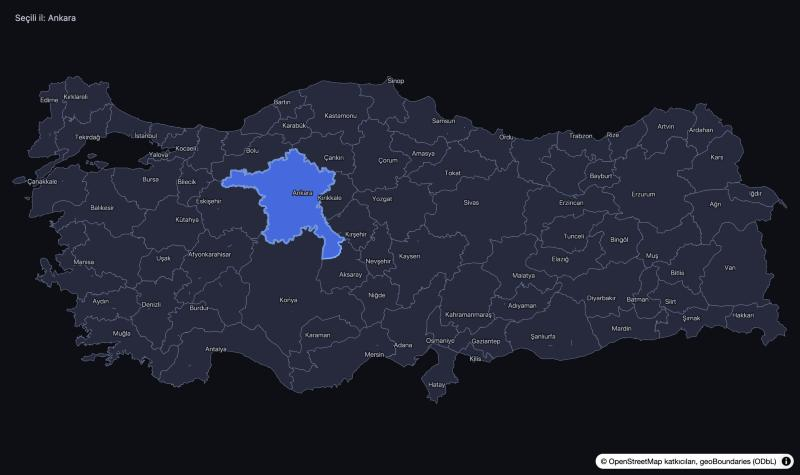

**Prototip: ilçe düzeyi (İstanbul/Beyoğlu seçili; kamera ilçeye yakın, üretimde il sınırına ayarlanır)**

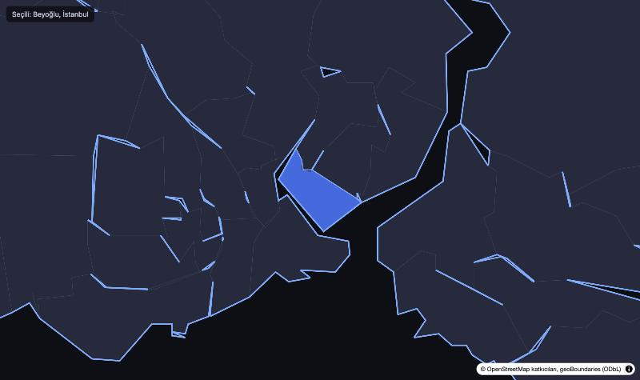

Prototip kodu A bölümündeki stil ve seçim kodunun birebir uyarlaması; `maplibre-gl` 6.14, depodaki `districts.txt` verisi, dış servis yok.

### 0.3 Raporlar arasındaki farklar ve çözümüm

| Konu | A (harita) | C (tasarım) | B (üretim) | Önerim |
|---|---|---|---|---|
| Karo altlığı | Yok | Yok | — | **Yok.** İki rapor bağımsız aynı sonuca vardı. OpenFreeMap yalnızca ileride ilçe içi ayrıntı gerekirse |
| İl → ilçe akışı | İle dokun → yakınlaş → ilçe seç | İl yeterli, ilçe isteğe bağlı | — | **C'nin yolu.** İl seçilince "Sahneyi gör" aktif olsun, ilçe seçimi ek adım. B'nin önerdiği "81 il × kova" üretimiyle de uyumlu: ilçe seçilmezse il sahnesi |
| İlçe verisi | Tek dosya (194 KB gzip) | İl TopoJSON + il başına ilçe parçaları | — | **Önce tek dosya** (ölçtüm: 215 KB gzip, kabul edilebilir). Bölme, ölçüm gerekçe gösterirse sonra |
| Dönem tablosu | — | 14 bant (yıl ekranı) | 15 kova (üretim) | **Tek tablo.** B'nin 15 kovası daha ince (Bizans/Selçuklu/Osmanlı klasik-geç ayrımı üretim için gerekli); C'nin yıl ekranı bantları buna hizalanır. Tarihçi kontrolü ikisinde de şart |
| "Bugün" | — | 2026 görünümü notu | Kova 13 = Faz 1 hattı | Uyumlu: yıl 2000–2030 seçilirse Faz 1'in gerçek görseli, aksi hâlde üretilmiş sahne |
| Tarih öncesi ve gelecek kovaları | — | Yıl ekranında var | Prosedürel 3B önerisi | **MVP'de "bu dönem için sahne henüz yok" demek** daha dürüst ve ucuz; prosedürel yol sanat yükü yüzünden sonraya |

### 0.4 Her rapor için eleştirim

**A (harita).** Güçlü yanı: kod derlenmiş ve stil doğrulayıcıdan geçmiş; lisans tablosu birincil kaynaklı; GADM'nin ticari yasağı ve OSM karo politikası doğru yakalanmış. Eksikleri: tarayıcıda çalıştırılmamıştı (ben çalıştırdım, çalışıyor); erişilebilirlik için "liste/arama" yedeği öneriliyor ama tasarlanmamış, C bunu tamamlıyor. Önerisine katılıyorum.

**B (sahne üretimi).** En değerli bölüm 2.1: yıl aralığını dönem kovalarına indirgemek, sorunun tamamını çözen fikir. Hacim hesabı ve Commons kapsam ölçümü (İstanbul 103.635 dosya, Yozgat 0) gerçekçi beklenti kuruyor. Eleştirilerim: (1) Mac mini M2 8 GB süreleri tümüyle tahmin; pilot olmadan "2,5–5 gün" rakamına güvenilmemeli. (2) "Önce arazi" yolu (ışın izleme + ERP üzerinde derinlik koşullu boyama) henüz denenmemiş; pilotun ilk işi bu olmalı, çünkü bütün karma yol buna dayanıyor. (3) SDXL-360 lisansı zayıf (yukarıda). (4) 9 karar fazla; aşağıda 8'e indirdim ve bir kısmını varsayılan olarak üstlendim. (5) "Belge / Yorum / Kurgu" etiketi ve insan figürü üretmeme kuralı doğru ve ucuz; benimsenmeli.

**C (tasarım).** Höyük kesiti metaforu projeye özgü ve logaritmik ölçeği görünür kılıyor; erişilebilirlik ve performans gerekçeleri sağlam; lisans seçimleri (Motion MIT, GSAP hayır) doğru. Eleştirilerim: (1) Metafor ilk kullanıcıya açıklanmak zorunda; A konsepti (dönem kartları) daha az öğrenme ister, ucuz yedek olarak tutulmalı. (2) Emek tahmini 16 insan günü; ajanlarla daha kısa sürer ama test ve gerçek tarayıcı doğrulaması aynı kalır. (3) Yükleme aşamaları için backend'e `stage` alanı küçük ama Faz 3'ün ilk backend işi olur. (4) Konsept D (3B uzay) ilk yükü 4 kat artırıyor; sonraya bırakılması doğru.

### 0.5 Sahibinin vereceği kararlar (#57)

★ önerilen seçenek. Cevap tek satır yeterli, ör. **"1A 2A 3C 4A 5A 6A 7A 8A"**.

1. **Harita:** A) MapLibre, altlıksız ★ · B) MapLibre + soluk OpenFreeMap zemini · C) D3-geo ile yeniden yazım
2. **Seçim akışı:** A) il seçilince devam edilebilir, ilçe isteğe bağlı ★ · B) ilçe zorunlu · C) yalnızca il
3. **Yıl ekranı:** A) dönem kartları · B) kadran · C) höyük kesiti ★ · D) 3B uzay
4. **Dönem tablosu:** A) B raporundaki 15 kova, yıl ekranı buna hizalanır ★ · B) C raporundaki 14 bant · C) sahibi kendi listesini verir
5. **Sahne üretim yolu:** A) karma: gerçek arazi + yerel model + varsa arşiv ★ · B) yalnızca arşiv + arazi, üretim yok · C) yalnızca prosedürel
6. **Pilot:** A) 5 yer × 4 kova, Mac mini'de SDXL-360 ile klein 4B karşılaştırması ★ · B) önce yalnızca arşiv kapsam taraması · C) pilotu atla, doğrudan 81 il
7. **Tarih öncesi ve gelecek kovaları (MVP):** A) "bu dönem için sahne henüz yok" ★ · B) prosedürel stilize sahne · C) model üretimi + "kurgu" etiketi
8. **Yönlendirme ve geçişler:** A) React Router v8 + React `<ViewTransition>` ★ · B) TanStack Router · C) kendi durum makinemiz

**Sormadan üstlendiğim varsayılanlar** (itiraz edilebilir): MÖ yılı URL'de `mo-1200`; yükleme aşamaları için backend'e `stage` alanı; üretimde insan figürü yok; arşiv lisans süzgeci yalnızca PD/CC0/CC BY/CC BY-SA; depolama önce Cloudflare Pages, gerekirse R2; sahne başına "Belge / Yorum / Kurgu" etiketi ve kaynak listesi; Mapillary logosu kararı hâlâ açık.

### 0.6 Faz 3 için önerilen sıra

Kararlar gelince açılacak işler (her biri ayrı issue):

1. **Yönlendirme ve üç sayfa iskeleti** (React Router v8, URL'ler, geri tuşu).
2. **Altlıksız harita** (il/ilçe poligonları, feature-state seçim, arama/liste yedeği, ODbL atfı). Veri derleme betiği ham geoBoundaries'ten ortak topolojiyle.
3. **Yıl ekranı** (seçilen konsept, dönem tablosu, yazma, klavye, reduced motion).
4. **Sahne sayfası** tam ekran + yükleme ekranı; backend `stage` alanı.
5. **Üretim pilotu** (B §5 adım 0–2): kova tablosu, arazi ışın izleme denemesi, 20 sahne, ölçümler → ikinci karar turu.
6. Pilot olumluysa **81 il × kova toplu üretim** ve `PrebuiltSceneGenerator`.
7. Faz 1'den taşınan küçük işler (#56'da listeli): 503 yeniden deneme, 2.5B ince nesne bozulması, derinlik ölçeği.

---

## A. Harita araştırması (#54): il/ilçe seçimi, ücretsiz kaynaklar

Tarih: 25.10.2026 · Kapsam: Türkiye il/ilçe seçim haritası (Time Portal frontend) · Depo değiştirilmedi.

İşaretler: **[ölçüm]** bu araştırmada çalıştırılıp ölçüldü · **[birincil]** resmi sayfa/lisans metninden okundu · **[tahmin]** hesap/çıkarım · **[doğrulanmadı]** kaynakla teyit edilemedi.

---

### 1. Özet

- **Tasarım MapLibre ile ulaşılabilir.** GeoJSON kaynağı, `fill`/`line` katmanları ve `feature-state` ile seçilmemiş yerler gri, seçilen yer açık lacivert boyanabilir. Bölüm 3'teki kod, depodaki MapLibre 6.14 tiplerine karşı `tsc` ile derlendi. MapLibre'nin kendi stil doğrulayıcısından da 0 hatayla geçti **[ölçüm]**. Tarayıcıda çalıştırılmadı.
- **Öneri: MapLibre'de kalın, altlık karoyu bırakın ("altlıksız" harita).** Boş bir stil, koyu arka plan ve depodaki il/ilçe poligonları yeterli. Sahibinin "gri ülke + lacivert seçim" tasarımına en yakın yol bu. Karo sağlayıcısı, anahtar ve kullanım politikası riski kalmıyor. Çevrimdışı da çalışıyor.
- **Veri küçük [ölçüm]:** 973 ilçe, 0,005° sadeleştirmeyle 194 KB gzip. 81 il 76 KB gzip. Toplam yaklaşık 270 KB, 1 MB hedefinin çok altında. Karşılaştırma için hazır bir ilçe SVG'si (ogun) 67 MB.
- **Altlık gerekirse ücretsiz ve anahtarsız seçenek OpenFreeMap.** "Dark" stili var. Kendi barındırma için Protomaps PMTiles kullanılabilir; Türkiye z15 yaklaşık 0,8 GB **[tahmin]**. OSM raster karoları üretimde güvenilmez (SLA yok, haber vermeden engellenebilir). CARTO artık anahtar istiyor, Stadia'nın ücretsiz katmanı ticari kullanıma kapalı. Mapbox ve Google anahtarlı ve ücretli, bu yüzden elendi.
- **Sınır verisi:** Mevcut geoBoundaries ilçe verisi (OSM kaynaklı, ODbL) yeterli. İl poligonlarını ilçelerden birleştirerek (dissolve) üretmek backend ile tutarlılığı garanti eder. **GADM'nin ticari kullanımı yasak**, kullanılmamalı. HDX/OCHA verisi (HGM kaynaklı) CC BY-IGO lisanslı, ama kaynak notunda "yalnızca insani amaçlı" ifadesi var, yani durum belirsiz.
- **Alternatifler:** Tasarım açısından eşdeğer olan tek seçenek D3-geo (SVG). Geçiş maliyeti, kendi yazılacak zoom/etiket/dokunma işi ve ileride küre/3B ihtiyacı değişikliği gerekçesiz kılıyor. Leaflet, OpenLayers, deck.gl ve Cesium ya geride kalıyor ya da bu iş için fazla ağır.
- **Sahibinin vereceği kararlar** (bölüm 8): harita yaklaşımı, seçim akışı (il → ilçe), sınır verisi kaynağı ve #20/#27'nin (OpenFreeMap) akıbeti.

---

### 2. İsterler ve kısıtlar

| İster / kısıt | Kaynak | Bu rapordaki karşılığı |
|---|---|---|
| Harita için para ödenmez, yalnızca ücretsiz kaynak | Sahip, karar #17 | Ücretli ya da kotası dolunca ücretlenen servisler elendi |
| API anahtarı istenmez; ücretsiz hesap ancak gerekçeyle | Sahip | Anahtarsız seçenekler önde |
| Haritada il, şehir ve ilçe seçilebilmeli; sınırlar görünmeli | Sahip | İl → ilçe iki adımlı seçim (bölüm 3) |
| Seçilmemiş yerler gri, seçilen açık lacivert | Sahip | `feature-state` + `case` ifadesi |
| Uygulama koyu temalı (`#0b0d14`, vurgu `#8ab4ff`) | `frontend/src/index.css` | Palet bu renklere göre seçildi |
| Backend tıklanan noktanın enlem/boylamından ilçe buluyor | `PolygonDistrictLocator` | Seçimde de tıklanan nokta gönderilebilir, API değişmez |
| İlçe verisi ODbL, kod MIT | `backend/.../geo/README.md` | Tarayıcıya gönderilen türetilmiş veri de ODbL ile sunulmalı |
| Faz 1'de görsel ilçe merkezinden bulunuyor | `docs/DURUM.md` | İlçe içindeki kesin nokta sonucu değiştirmiyor. Bu yüzden ayrıntılı altlığa ihtiyaç düşük (yorum) |
| Bugünkü durum | `LocationPicker.tsx` | MapLibre 6.14 + `demotiles` (Natural Earth ülke poligonları, z0–6, yalnızca demo ve CI için), 320 px yükseklik, işaretçi (marker) |

---

### 3. MapLibre ile mümkün mü?

**Evet.** İstenen her parça MapLibre'nin standart yeteneği:

- **GeoJSON + fill/line:** GeoJSON kaynağı web worker içinde vektör karoya çevrilir. Kaynağın `tolerance` seçeneği (varsayılan 0,375) her zoom'da ek Douglas–Peucker sadeleştirmesi yapar **[birincil: style-spec sources]**.
- **Seçim ve hover:** `map.setFeatureState({source, id}, {selected: true})` çağrılır, paint özelliğinde `['feature-state', 'selected']` okunur. Kimlik için `promoteId` (bir özelliği kimlik yapar) ya da `generateId` kullanılır. Doğrulayıcıya göre `fill-color`, `line-color`, `line-width` ve `line-opacity` feature-state'i destekliyor **[ölçüm]**.
  - Feature-state yalnızca paint özelliklerinde çalışır, filtrede çalışmaz.
  - `zoom` ifadesi en dışta olmalı. Taslağımdaki iç içe zoom hatasını doğrulayıcı yakaladı ve düzeltildi.
- **Veriye bağlı stil:** `get`, `match` ve `step` ifadeleriyle yapılır ("Visualize population density" örneği).
- **Etiketler (il adları):** v5.11'den beri stilde `glyphs` yoksa `text-font` yerel yazı tipi listesi sayılır. v6.7 ile `font-faces` geldi **[birincil: CHANGELOG]**. Yani altlıksız stilde font sunucusu gerekmez, Türkçe karakterler sistem yazı tipinden gelir.
- **Küre:** v5.0.0'da (Ocak 2025) geldi. `map.setProjection({type: 'globe'})` ile açılır. Stilde `projection` ile zoom'a göre küreden düz haritaya geçiş de mümkün.
- **3B:** `fill-extrusion` (3B binalar), arazi (terrain) ve three.js özel katman örnekleri var.
- **PMTiles:** `pmtiles` paketi (7,7 KB gzip) ve `addProtocol` ile.
- **Stil düzenleme:** Maputnik (MIT) tarayıcıda görsel stil editörü.
- **v6 notu:** v6.0.0 (Temmuz 2026) ile paket yalnızca ESM oldu ve WebGL2 zorunlu hale geldi **[birincil]**. Mevcut kod `setWorkerUrl` ile zaten ESM kullanıyor. Güncel sürüm 6.16.0, depoda 6.14.0 var.

**Performans [ölçüm: kendi Douglas–Peucker betiği; mapshaper değil]:**

| Veri | Köşe | Ham | gzip |
|---|---|---|---|
| 973 ilçe, `districts.txt` olduğu gibi (0,0015°, 4 ondalık) | 103.818 | 1,97 MB | 518 KB |
| 973 ilçe, 0,003°, 3 ondalık | 63.936 | 1,14 MB | 270 KB |
| 973 ilçe, 0,005°, 3 ondalık | 43.393 | 0,81 MB | 194 KB |
| 973 ilçe, 0,01°, 3 ondalık | 25.230 | 0,53 MB | 123 KB |
| 81 il (geoBoundaries ADM1 sadeleştirilmiş), 0,005° | 15.945 | 0,26 MB | 76 KB |
| 81 il, 0,01° | 8.736 | 0,15 MB | 43 KB |
| geoBoundaries'in hazır ADM2 "simplified" GeoJSON'u | — | 3,87 MB | 1,20 MB |
| MapLibre 6.14 JS + worker (`node_modules`) | — | 1,59 MB | 430 KB |

Bu boyutlar MapLibre için küçük. Akıcı çizim beklenir **[tahmin; tarayıcıda FPS ölçülmedi]**.

Betiğim halkaları tek tek sadeleştirdiği için komşu ilçeler arasında ince boşluklar oluşabilir. Üretimde komşu sınırları ortak tutan bir araç kullanılmalı: mapshaper (MPL-2.0, yalnızca derleme anında). TopoJSON ek küçültme sağlar ama tarayıcıda `topojson-client` (2,5 KB gzip) ile GeoJSON'a çevirmek gerekir. TopoJSON'un getireceği kazancı ölçmedim **[doğrulanmadı]**.

**Mobil:**
- `click` olayı dokunmada da tetiklenir, ama hover yoktur. Bu yüzden akış şöyle olmalı: ile dokun → ile yakınlaş → ilçeye dokun. İstanbul'daki gibi küçük ilçeler tek adımda isabetle seçilemez.
- `dragRotate: false`, `touchPitch: false` ve `touchZoomRotate.disableRotation()` ile 2B'ye sabitlenir.
- Harita sayfa kaydırmasıyla çakışırsa `cooperativeGestures` kullanılır: mobilde iki parmak, masaüstünde Ctrl/Cmd gerekir.

**Erişilebilirlik (yorum):** Canvas haritada klavyeyle poligon seçilemez. Yedek olarak bir il/ilçe arama kutusu ya da listesi önerilir.

#### Çalışır kod parçası (gri / açık lacivert seçim)

`turkeyStyle.ts`: altlıksız stil (tsc ✓, `validateStyleMin` → 0 hata):

```ts
import type { StyleSpecification, ExpressionSpecification } from 'maplibre-gl'

// Uygulamanın koyu temasıyla uyumlu renkler (index.css: #0b0d14, vurgu #8ab4ff)
const C = {
  background: '#0b0d14', // deniz/boşluk = sayfa arka planı
  land: '#2a3046',       // seçilmemiş il/ilçe: gri-lacivert
  hover: '#3a4362',
  selected: '#4f74e8',   // seçili: açık lacivert
  provinceLine: '#7d86a6',
  districtLine: '#454d6b',
  selectedLine: '#8ab4ff',
  label: '#c9cede',
}

export const ILCE_ZOOM = 7 // bu zoom'dan itibaren ilçeler görünür

// feature-state'e göre dolgu: seçili > üzerinde > varsayılan
const fillByState: ExpressionSpecification = [
  'case',
  ['boolean', ['feature-state', 'selected'], false], C.selected,
  ['boolean', ['feature-state', 'hover'], false], C.hover,
  C.land,
]

export const turkeyStyle: StyleSpecification = {
  version: 8,
  // "glyphs" yok: MapLibre ≥5.11 text-font'u yerel yazı tipi listesi sayar, PBF font sunucusu gerekmez
  sources: {
    provinces: { type: 'geojson', data: '/geo/provinces.json', promoteId: 'code' },
    districts: { type: 'geojson', data: '/geo/districts.json', promoteId: 'code' },
    'province-labels': { type: 'geojson', data: '/geo/province-centers.json' },
  },
  layers: [
    { id: 'bg', type: 'background', paint: { 'background-color': C.background } },
    { id: 'province-fill', type: 'fill', source: 'provinces', maxzoom: ILCE_ZOOM,
      paint: { 'fill-color': fillByState } },
    { id: 'district-fill', type: 'fill', source: 'districts', minzoom: ILCE_ZOOM,
      paint: { 'fill-color': fillByState } },
    { id: 'district-line', type: 'line', source: 'districts', minzoom: ILCE_ZOOM - 1,
      paint: {
        'line-color': C.districtLine,
        'line-width': 0.6,
        'line-opacity': ['interpolate', ['linear'], ['zoom'], ILCE_ZOOM - 1, 0, ILCE_ZOOM, 1],
      } },
    { id: 'province-line', type: 'line', source: 'provinces',
      paint: {
        'line-color': ['case', ['boolean', ['feature-state', 'selected'], false], C.selectedLine, C.provinceLine],
        // zoom ifadesi en dışta olmalı (stil doğrulayıcısı iç içe zoom'u reddediyor)
        'line-width': ['interpolate', ['linear'], ['zoom'],
          5, ['case', ['boolean', ['feature-state', 'selected'], false], 2.5, 0.6],
          9, ['case', ['boolean', ['feature-state', 'selected'], false], 3, 1.4]],
      } },
    { id: 'district-selected-line', type: 'line', source: 'districts', minzoom: ILCE_ZOOM,
      paint: {
        'line-color': C.selectedLine,
        'line-width': 2,
        'line-opacity': ['case', ['boolean', ['feature-state', 'selected'], false], 1, 0],
      } },
    { id: 'province-label', type: 'symbol', source: 'province-labels', maxzoom: ILCE_ZOOM + 1,
      layout: {
        'text-field': ['get', 'name'],
        'text-font': ['system-ui', 'Helvetica Neue', 'Arial'],
        'text-size': ['interpolate', ['linear'], ['zoom'], 5, 10, 8, 14],
        'text-allow-overlap': false,
      },
      paint: { 'text-color': C.label, 'text-halo-color': C.background, 'text-halo-width': 1.2 } },
  ],
}
```

`turkeyMap.ts`: seçim ve hover (tsc ✓):

```ts
import { Map as MapLibreMap } from 'maplibre-gl'
import { turkeyStyle, ILCE_ZOOM } from './turkeyStyle'

type Ref = { source: 'provinces' | 'districts'; id: string | number }

export function wireSelection(
  map: MapLibreMap,
  onDistrict: (d: { code: string; name: string; province: string; lat: number; lng: number }) => void,
) {
  let hovered: Ref | undefined
  let selected: Ref[] = []

  const setHover = (ref?: Ref) => {
    if (hovered) map.setFeatureState(hovered, { hover: false })
    hovered = ref
    if (hovered) map.setFeatureState(hovered, { hover: true })
  }
  const setSelected = (refs: Ref[]) => {
    for (const r of selected) map.setFeatureState(r, { selected: false })
    selected = refs
    for (const r of selected) map.setFeatureState(r, { selected: true })
  }

  for (const [layer, source] of [['province-fill', 'provinces'], ['district-fill', 'districts']] as const) {
    map.on('mousemove', layer, (e) => {
      const f = e.features?.[0]
      if (f?.id !== undefined) setHover({ source, id: f.id })
      map.getCanvas().style.cursor = 'pointer'
    })
    map.on('mouseleave', layer, () => {
      setHover(undefined)
      map.getCanvas().style.cursor = ''
    })
  }

  // İl düzeyi: dokun/tıkla → il seçilir ve ile yakınlaşılır (ilçeler ILCE_ZOOM'da belirir)
  map.on('click', 'province-fill', (e) => {
    const f = e.features?.[0]
    if (f?.id === undefined) return
    setSelected([{ source: 'provinces', id: f.id }])
    // Sınır kutusu derleme anında özelliklere yazılır: sorgudan dönen geometri karoya kırpılmış olabilir
    const b = f.properties as { minLng: number; minLat: number; maxLng: number; maxLat: number }
    const cam = map.cameraForBounds([[b.minLng, b.minLat], [b.maxLng, b.maxLat]], { padding: 24, maxZoom: 9 })
    // Büyük illerde (Konya gibi) sığdırma zoom'u ILCE_ZOOM'un altında kalabilir; ilçeler görünsün diye alt sınır
    if (cam) map.easeTo({ ...cam, zoom: Math.max(cam.zoom ?? ILCE_ZOOM, ILCE_ZOOM) })
  })

  // İlçe düzeyi: seçilen ilçe + ait olduğu il vurgulanır, konum dışarı bildirilir
  map.on('click', 'district-fill', (e) => {
    const f = e.features?.[0]
    if (f?.id === undefined) return
    const p = f.properties as { name: string; province: string; provinceCode: string }
    setSelected([
      { source: 'districts', id: f.id },
      { source: 'provinces', id: p.provinceCode },
    ])
    onDistrict({ code: String(f.id), name: p.name, province: p.province, lat: e.lngLat.lat, lng: e.lngLat.lng })
  })
}

export function createTurkeyMap(container: HTMLElement, onDistrict: Parameters<typeof wireSelection>[1]) {
  const map = new MapLibreMap({
    container,
    style: turkeyStyle,
    bounds: [[25.6, 35.8], [44.9, 42.2]],
    fitBoundsOptions: { padding: 16 },
    dragRotate: false,      // 2B seçim haritası: döndürme/eğme kapalı
    pitchWithRotate: false,
    touchPitch: false,
    renderWorldCopies: false,
    attributionControl: { compact: true, customAttribution: '© OpenStreetMap katkıcıları, geoBoundaries (ODbL)' },
  })
  map.touchZoomRotate.disableRotation() // iki parmakla yakınlaştırma kalsın, döndürme kapansın
  map.on('load', () => wireSelection(map, onDistrict))
  return map
}
```

**Kodun beklediği veri.** Bunlar derleme betiğiyle `frontend/public/geo/` altına üretilir:
- `districts.json`: özellikler `code`, `name`, `province`, `provinceCode`.
- `provinces.json`: özellikler `code`, `name`, `minLng`, `minLat`, `maxLng`, `maxLat`. MapLibre dizi ya da nesne özellikleri sorgu sonucunda metne çevirdiği için sınır kutusu dört ayrı sayı olarak tutulur.
- `province-centers.json`: depodaki `province-centers.tsv`'den üretilen nokta katmanı.

Örnek veri hazırlığı (çalıştırılmadı):

```
mapshaper districts.geojson -simplify dp interval=500 keep-shapes -o precision=0.001 districts.json
mapshaper districts.json -dissolve provinceCode copy-fields=province -o provinces.json
```

**Görsel davranış:**
- Zoom 7'nin altında 81 il gri görünür, seçilen il açık lacivert dolgu alır ve `#8ab4ff` kenar çizgisiyle belirir.
- Zoom 7 ve üstünde ilçeler gri görünür. Seçilen ilçe lacivert dolgu ve açık kenar alır, ait olduğu il kalın açık çizgiyle çevrelenir.
- Tıklanan noktanın koordinatı yine gönderilir, backend sözleşmesi değişmez.

---

### 4. Seçenek karşılaştırması

Lisans, sürüm ve yıldızlar GitHub/npm'den, gzip boyutları bundlephobia'dan **[ölçüm, 25.10.2026]**. MapLibre boyutu `node_modules`'tan ölçüldü. Bundlephobia değerleri paketin tamamını yansıtır; tree-shaking ile değişir.

| Seçenek | Lisans | Anahtar | İl/ilçe seçimi | Görsel kalite | Mobil | Paket (gzip) | 3B / küre | Topluluk | Tasarıma ulaşma emeği |
|---|---|---|---|---|---|---|---|---|---|
| **MapLibre + karo** (OpenFreeMap) | BSD-3 | Yok | Kolay (`feature-state`) | Yüksek: yol, yer adı | İyi | ~430 KB | Küre, arazi, extrusion, three.js | 11,9k ★ | Orta: altlığın renklerini koyu temaya uydurmak, sınır katmanını üste eklemek |
| **MapLibre altlıksız** | BSD-3 (veri ODbL) | Yok, ağ bağımlılığı da yok | Çok kolay | Sade ve stilize, tasarıma en yakın | İyi | ~430 KB + veri ~270 KB | Aynı | Aynı | **Düşük**: aynı kütüphane, yalnızca stil ve veri değişir |
| Leaflet 1.9.4 (2.0 hâlâ alfa) | BSD-2 | Yok (altlık hariç) | Kolay (`setStyle`, resmi choropleth örneği) | Raster altlıkla orta | İyi | 43 KB | Yok | 45,8k ★ | Orta: yeniden yazım, vektör altlık için eklenti |
| OpenLayers 10.11 | BSD-2 | Yok | Orta (`Select` etkileşimi) | İyi | İyi | ~86 KB | Sınırlı (ol-cesium) | 12,6k ★ | Orta-yüksek: daha ayrıntılı API |
| D3-geo + d3-zoom (SVG) | ISC | Yok | Kolay (`path` tıklama) | Tamamen özelleştirilebilir | Orta: büyük SVG'de zoom ağırlaşır | ~29 KB | Yok | d3 113,8k ★ | Orta: zoom, etiket çakışması ve dokunma elle yazılır |
| deck.gl 9.4 | MIT | Yok | Kolay (`GeoJsonLayer` pickable + highlight) | Büyük veride güçlü | İyi | ~275 KB | Güçlü | 14,7k ★ | Orta: bu iş için fazla |
| CesiumJS 1.146 | Apache-2.0 | Varsayılan ion token (kapatılabilir) | Orta (entity picking) | 3B küre | Ağır | ~1,35 MB | En güçlü | 15,9k ★ | Yüksek: aşırı |
| ~~Mapbox GL JS 3.33~~ | Tescilli (Mapbox ToS) | Hesap ve token | — | — | — | — | — | — | **Elendi:** 50 bin yükleme/ay sonrası ücretli |
| ~~Google Maps JS~~ | Tescilli | Anahtar ve faturalama | — | — | — | — | — | — | **Elendi:** 10 bin olay/ay sonrası 1000 başına 7 $ |

---

### 5. Karo ve sınır verisi kaynakları

#### 5a. Karo / altlık

| Kaynak | Anahtar | Ücret / sınır | Atıf | Not |
|---|---|---|---|---|
| **OpenFreeMap** | Yok | Görüntüleme ya da istek sınırı yok **[birincil]**. Toplu indirme 3.000 karo / 50 MB ile sınırlı. Aylık bağış rica ediliyor | "OpenFreeMap © OpenMapTiles Data from OpenStreetMap" | Stiller: Liberty, Bright, Positron, **Dark**, Fiord, 3D. 5 stil URL'si 200 döndü **[ölçüm]**. Kendi barındırma da mümkün |
| **Protomaps PMTiles** (kendi barındırma) | Yok | Ücretsiz; dosyayı kendiniz barındırırsınız | ODbL Produced Work, OSM atfı zorunlu | Gezegen dosyası yaklaşık 120 GB (z0–15). `pmtiles extract --bbox` ile bölge kesilir. **Türkiye z15 ≈ 0,8 GB, z12 ≈ 100 MB [tahmin]**: Türkiye PBF'i 652 MB, gezegen 95,5 GB (oran %0,68); her zoom düşüşü boyutu yaklaşık yarıya indirir. Daha koyu "flavor" seçenekleri: dark, black, grayscale |
| Protomaps barındırılan API | **Var** | Yalnızca ticari olmayan kullanımda ücretsiz | OSM | Elenir (anahtar gerekli) |
| MapLibre demotiles | Yok | — | Natural Earth | Yalnızca demo ve CI için; z0–6, ülke poligonları. **Üretim için değil** |
| **OSM raster** (tile.openstreetmap.org) | Yok | **Üretimde güvenilmez**: "SLA yok", erişim "haber verilmeden" engellenebilir; toplu ve çevrimdışı kullanım yasak; ticari servisler için "her an geri çekilebilir" **[birincil]** | Görünür OSM atfı | Önerilmez |
| OSMF vektör karoları | Yok | Raster ile aynı ilkeler, SLA yok | Görünür atıf | Önerilmez |
| CARTO (Positron / Dark Matter) | **Var** (e-postayla gelir) | Ticari olmayan kullanım 5M istek/ay, ticari 1M/ay ücretsiz; sonrası aylık 500 $'dan başlar | © OSM, © CARTO | Anahtar ister, elenir |
| Stadia Maps | Hesap | Ücretsiz plan 200 bin kredi/ay, **ticari kullanım yok** | OSM, Stadia | Elenir |
| Esri | Hesap ve token | 2M karo/ay ücretsiz, sonra 1000 karo başına 0,15 $ **[ikincil kaynak]** | Esri | Elenir |
| VersaTiles | Görünüşe göre yok | Kullanım şartları bulunamadı **[doğrulanmadı]** | OSM | Kendi barındırmaya uygun FLOSS yığın; koyu stil var |

#### 5b. Sınır verisi (il = ADM1, ilçe = ADM2)

| Kaynak | Kapsam | Lisans **[birincil]** | Uygunluk |
|---|---|---|---|
| **geoBoundaries gbOpen TUR** (kullanımda) | ADM1: 81 il. ADM2: 999 birim (depo 973'e indirgemiş) | ADM2 meta verisi: **ODbL 1.0**. ADM1 meta verisi: "CC BY-SA 2.0". Site geneli CC BY 4.0 diyor. Kaynak OSM olduğu için pratikte ODbL geçerli (yorum; meta veriler tutarsız) | ✔ Atıf "© OpenStreetMap contributors, geoBoundaries" (sitede geoBoundaries bağlantısı istenir) |
| OSM sınırları (doğrudan) | İl ve ilçe | ODbL | ✔ İşleme gerektirir |
| HDX COD-AB TUR (OCHA) | 81 il, 973 ilçe; HGM kaynaklı, 1:1M, sınırlar 2014 | **CC BY-IGO**. Ancak yöntem notu kaynağı "yalnızca insani amaçlı kullanım için paylaşıldı" diye anlatıyor | ⚠ Resmî adlar ve PCODE için çekici, ama lisans belirsiz |
| Natural Earth | Yalnızca admin-1 (il), 1:10m | **Kamu malı**, atıf gerekmez | ◐ İl sınırları ve komşu ülke bağlamı için uygun. Türkiye'de 81 il olduğu **[doğrulanmadı]** |
| **GADM** | ADM1, ADM2 | "Redistribution or **commercial use is not allowed** without prior permission" | ✘ **Kullanılmamalı** |
| Wikidata | Yalnızca merkez noktaları | CC0 | ✔ Zaten kullanılıyor (etiket noktaları için) |
| Overture Divisions | İdari sınırlar | division_boundary: ODbL | ◐ Gereksiz; kaynak karışık |
| HGM / TÜİK doğrudan | Mülki idare sınırları | Güncel açık lisans metni bulunamadı **[doğrulanmadı]** | ✘ Netleşene kadar kullanılmamalı |

**ODbL notu:** Tarayıcıya gönderilen sadeleştirilmiş GeoJSON "uyarlanmış veritabanı" sayılır. Herkese açık kullanımda ODbL ile sunulmalı ve atfı korunmalıdır. Harita görüntüsünde "© OpenStreetMap katkıcıları" görünmelidir.

---

### 6. Örnek projeler ve görseller

Her görsel URL'si için 25.10.2026'da `curl -L` çalıştırıldı ve HTTP 200 ile `image/*` yanıtı alındı **[ölçüm]**. Durum her görselin altında yazıyor.

#### 6a. MapLibre ile yapılanlar

**1. MapLibre: "Create a hover effect".** Tam olarak önerilen teknik: ABD eyaletleri, `feature-state` ile hover vurgusu.

*200 image/png · maplibre.org*

**2. MapLibre: "Show polygon information on click".** Poligona tıklayınca bilgi gösterir.

*200 image/png*

**3. MapLibre: "Visualize population density".** Veriye bağlı dolgu (choropleth).

*200 image/png*

**4. MapLibre: küre görünümü (v5+).**

*200 image/png*

**5. MapLibre: 3B binalar (`fill-extrusion`).**

*200 image/png*

**6. MapLibre + PMTiles (Protomaps protokolü).**

*200 image/png*

**7. OpenHistoricalMap.** MapLibre tabanlı, alttaki **yıl kaydırıcısıyla** tarihsel sınırları gösteriyor. Time Portal'ın "yıl + yer" fikrine en yakın canlı örnek. Ekran görüntüsü: Commons, CC BY-SA 4.0.

*200 image/png*

**8. OpenFreeMap.** Anahtarsız karo servisi; tanıtım görselinde 3D stil var.

*200 image/png*

**9. VersaTiles "muted-dark" stili.** Koyu temalı bir MapLibre altlığı nasıl görünür, onu gösteriyor.

*200 image/png*

**10. Protomaps.** Tanıtım kolajı; tek bir harita ekranı değil.

*200 image/jpeg*

**11. kepler.gl.** deck.gl ile MapLibre altlığı birlikte kullanan açık kaynak analiz aracı.

*200 image/png*

**12. Maputnik (stil editörü).** README'deki GIF (`j.gifs.com/g5XMgl.gif`) yanıt vermedi. **Görsel doğrulanamadı.** Bağlantı: https://maplibre.org/maputnik/

#### 6b. Altlıksız / D3 / SVG (karşılaştırma için)

**13. "Ankara in Turkey" konum haritası** (Commons, TUBS, CC BY-SA 3.0). Sahibinin tarif ettiği tasarımın statik hali: düz ülke, ince il sınırları, seçili il vurgulu. Altlıksız MapLibre ile aynı görünüm koyu palette ve etkileşimli olarak elde edilir.

*200 image/png*

**14. Türkiye illeri, gri boş harita** (Commons, CC BY-SA 3.0). `dnomak/svg-turkiye-haritasi` (MIT, 550★) bu dosyadan türetilmiş.

*200 image/png*

**15. TopoJSON / D3: ABD ilçeleri (us-atlas).** İlçe yoğunluğunun düz SVG'de nasıl göründüğünü gösteriyor.

*200 image/png*

**16. react-simple-maps** (D3-geo + React, MIT, v5.0.5, React 19 destekli). Koyu zemin ve mavi tonlu SVG choropleth.

*200 image/jpeg*

**17. geoBoundaries TUR ADM2 önizlemesi.** Şu an kullandığımız verinin ham hali.

*200 image/png*

**18. ogun/turkiye-svg-ilce-haritasi** (MIT). Tüm ilçeler tek SVG'de. Görsel geçerli (200 image/svg+xml) ama **67 MB** olduğu için gömülmedi: https://raw.githubusercontent.com/ogun/turkiye-svg-ilce-haritasi/master/turkiye-ilceler.svg. Ders: SVG sadeleştirilmezse çok ağır olur.

#### 6c. Diğer kütüphaneler

**19. Leaflet resmi choropleth örneği.**

*200 image/png*

**20. deck.gl choropleth demosu.**

*200 image/jpeg*

---

### 7. Öneri ve gerekçe: devam mı, değişim mi?

**Önerim: MapLibre'ye devam. Ana seçim ekranında altlıksız stil kullanılsın; karo altlığı isteğe bağlı bir eklenti olarak kalsın.**

Gerekçeler:

1. **Tasarım uyumu.** Sahibinin tarifi bir yol haritası değil, idari bölüm seçici. Altlıksız stilde her piksel bizim renklerimizle çiziliyor: koyu zemin, gri il/ilçe, lacivert seçim. Karo altlığı eklenince yollar, su ve etiketler seçimle görsel olarak yarışıyor ve renkler koyu temaya ayrıca uydurulmak zorunda kalıyor. Görsel 13 bu sadeliğin statik halini gösteriyor.
2. **Ücretsizlik ve risk.** Altlıksız stilde dış karo isteği yok. Böylece OpenFreeMap'in bağışla yaşayan kapasitesine, OSM politikasına ya da gelecekte değişebilecek ücretsiz katmanlara bağımlılık da yok. Veri depoda ve sürüme sabit.
3. **Tutarlılık.** Ön yüzdeki poligonlar backend'in `PolygonDistrictLocator`'ının kullandığı veriden üretilirse ekranda seçilen ilçe ile backend'in bulduğu ilçe aynı olur. Bugün demotiles'taki kaba ülke sınırı ile backend'in poligonu farklı.
4. **Geçiş maliyeti düşük.** Aynı kütüphane, aynı `LocationPicker` iskeleti. Yalnızca `MAP_STYLE_URL` ve seçim mantığı değişiyor. D3'e geçmek zoom, dokunma, etiket ve test işini sıfırdan yazmak demek.
5. **Gelecek.** Asıl vizyon "dünya üzerinde konum" ve 3B. MapLibre'de küre (v5+), arazi, extrusion ve three.js özel katmanı zaten var. Projede kullanılan react-three-fiber ile ayrı görüntüleyicide birlikte yaşayabilir. Leaflet ve D3 bu yolu kapatıyor. Cesium ve deck.gl ise bugünkü iş için fazla ağır.
6. **Performans.** Ölçülen veri ~270 KB gzip. MapLibre kodu zaten yüklendiği için ek kütüphane maliyeti yok.

**Riskler ve önlemler:**
- **İlçe ölçeğinde bağlam eksikliği.** Kullanıcı ilçe içinde yer adı ya da yol göremez. Faz 1 ilçe merkezini kullandığı için bu sonucu değiştirmiyor. Faz 3'te kesin nokta önemli hale gelirse yüksek zoom'da OpenFreeMap "dark" altlığı (anahtarsız) eklenebilir: `minzoom` ile yalnızca ilçe düzeyinde görünür ve sınır katmanları üstte kalır.
- **Komşu ülkeler ve denizler boş görünür.** İsteğe bağlı olarak Natural Earth (kamu malı) ülke poligonları daha koyu tonda eklenebilir.
- **Küçük ilçeler (İstanbul, İzmir merkez).** İl → ilçe iki adımı ve gerekirse ek zoom bunu çözer.
- **Erişilebilirlik.** Canvas klavyeyle seçilemez. İl/ilçe arama listesi eklenebilir; bu, ayrıca bir tasarım kararı.

**İş büyüklüğü [tahmin]:** Tek issue'luk iş: veri üretim betiği, stil, seçim mantığı ve testler (stil doğrulama + birim testi). Bugünkü #27 (OpenFreeMap) issue'su bu kararla ya kapanır ya da "ileri zoom altlığı" olarak yeniden tanımlanır.

---

### 8. Sahibinin vereceği kararlar

**K1: Harita yaklaşımı**
- **A (öneri): MapLibre altlıksız.** Koyu zemin, gri il/ilçe, lacivert seçim. Veri depoda, dış servis yok.
- B: MapLibre + OpenFreeMap "dark" altlık + üstte il/ilçe katmanı. Daha çok bağlam, daha kalabalık görünüm, dış bağımlılık.
- C: D3-geo (SVG) ile yeniden yazım. Görsel olarak A'ya yakın, emek daha fazla, küre/3B yolu kapanır.

**K2: Seçim akışı**
- **A (öneri): İl → ilçe.** İle dokununca yakınlaşılır, ilçe seçilir. Mobilde isabetli.
- B: Doğrudan ilçe. Ülke görünümünde 973 ilçe; küçükler zor seçilir.
- C: Yalnızca il. Basit, ama karar #37'deki ilçe düzeyiyle çelişir.

**K3: Ön yüzde sınır verisi**
- **A (öneri): Mevcut geoBoundaries ilçeleri (ODbL); iller ilçelerden birleştirilerek üretilir.** Backend ile birebir aynı.
- B: HDX COD-AB (HGM kaynaklı, resmî adlar ve PCODE). Lisansı belirsiz ("yalnızca insani amaç" notu).
- C: Natural Earth il + geoBoundaries ilçe. İki kaynak, sınırlar örtüşmeyebilir.

**K4: #20/#27 (OpenFreeMap)**
- **A (öneri): K1=A seçilirse #27 "ileri zoom için isteğe bağlı altlık" olarak P2'ye çekilir.**
- B: #27 bugünkü haliyle (tam altlık) uygulanır.
- C: #27 kapatılır; altlık hiç kullanılmaz.

---

### 9. Kaynaklar (erişim: 25.10.2026)

**MapLibre:**
- Örnekler: https://maplibre.org/maplibre-gl-js/docs/examples/
- Hover örneği: https://maplibre.org/maplibre-gl-js/docs/examples/create-a-hover-effect/
- Tıklama örneği: https://maplibre.org/maplibre-gl-js/docs/examples/show-polygon-information-on-click/
- Küre örneği: https://maplibre.org/maplibre-gl-js/docs/examples/display-a-globe-with-a-vector-map/
- Web font etiket örneği: https://maplibre.org/maplibre-gl-js/docs/examples/style-labels-with-web-fonts/
- Style spec, kaynaklar: https://maplibre.org/maplibre-style-spec/sources/
- Style spec, projeksiyon: https://maplibre.org/maplibre-style-spec/projection/
- MapOptions: https://maplibre.org/maplibre-gl-js/docs/API/type-aliases/MapOptions/
- CHANGELOG (v5.0.0 küre, v5.11.0 yerel yazı tipi, v6.0.0 ESM/WebGL2, v6.7.0 font-faces): https://github.com/maplibre/maplibre-gl-js/blob/main/CHANGELOG.md
- Aralık 2024 bülteni (5.0 ve küre): https://maplibre.org/news/2025-01-05-maplibre-newsletter-december-2024/
- Demotiles: https://github.com/maplibre/demotiles
- Maputnik: https://github.com/maplibre/maputnik

**Karo ve altlık:**
- OpenFreeMap: https://openfreemap.org/ ve https://openfreemap.org/quick_start/
- Protomaps indirmeler: https://docs.protomaps.com/basemaps/downloads
- Protomaps flavors: https://docs.protomaps.com/basemaps/flavors
- PMTiles CLI: https://docs.protomaps.com/pmtiles/cli
- PMTiles + MapLibre: https://docs.protomaps.com/pmtiles/maplibre
- Protomaps API: https://protomaps.com/api
- Geofabrik Türkiye: https://download.geofabrik.de/europe/turkey.html
- OSM gezegen dosyası: https://planet.openstreetmap.org/pbf/
- OSMF karo politikası: https://operations.osmfoundation.org/policies/tiles/
- OSMF vektör karo politikası: https://operations.osmfoundation.org/policies/vector/
- CARTO: https://carto.com/basemaps ve https://github.com/CartoDB/basemap-styles
- Stadia: https://stadiamaps.com/pricing/
- Esri: https://location.arcgis.com/pricing/ (ikincil özet üzerinden)
- VersaTiles: https://versatiles.org/ ve https://docs.versatiles.org/

**Sınır verisi ve lisanslar:**
- geoBoundaries API: https://www.geoboundaries.org/api/current/gbOpen/TUR/ADM2/ (ve ADM1)
- geoBoundaries: https://www.geoboundaries.org/
- HDX COD-AB TUR: https://data.humdata.org/dataset/cod-ab-tur (CKAN API: `/api/3/action/package_show?id=cod-ab-tur`)
- GADM lisansı: https://gadm.org/license.html
- Natural Earth kullanım şartları: https://www.naturalearthdata.com/about/terms-of-use/
- ODbL özeti: https://opendatacommons.org/licenses/odbl/summary/
- OSM telif: https://www.openstreetmap.org/copyright
- Overture STAC: https://stac.overturemaps.org/2026-06-17.0/divisions/division_boundary/collection.json

**Ücretli seçenekler:**
- Mapbox fiyatlandırma: https://www.mapbox.com/pricing
- Mapbox GL JS lisansı: https://github.com/mapbox/mapbox-gl-js/blob/main/LICENSE.txt
- Google Maps: https://developers.google.com/maps/billing-and-pricing/pricing
- Cesium: https://cesium.com/pricing/ ve https://community.cesium.com/t/is-it-possible-to-use-cesiumjs-without-cesiumion/13587

**Diğer kütüphaneler ve örnekler:**
- Leaflet choropleth: https://leafletjs.com/examples/choropleth/
- Paket boyutları: https://bundlephobia.com/
- Paketler: npm (`npm view`) ve GitHub API
- Türkiye SVG haritaları: https://github.com/dnomak/svg-turkiye-haritasi ve https://github.com/ogun/turkiye-svg-ilce-haritasi
- Commons görselleri: https://commons.wikimedia.org/wiki/File:Ankara_in_Turkey.svg, https://commons.wikimedia.org/wiki/File:Turkey_provinces_blank_gray.svg, https://commons.wikimedia.org/wiki/File:Kuntisuyu_and_Antisuyu_in_1500_in_OpenHistoricalMap.png
- OpenHistoricalMap yeniden kullanım: https://wiki.openstreetmap.org/wiki/OpenHistoricalMap/Reuse

**Yerel ölçüm araçları** (scratchpad, depoya girmedi):
- Boyut betiği: `/private/tmp/claude-501/-Users-batuhanakdeniz-Desktop-repos-time-portal/155a3ed8-9f4d-417c-b47b-12e47450a0f7/scratchpad/harita-scripts/measure.py`
- Kod parçası, tsconfig ve doğrulayıcı: `/private/tmp/claude-501/-Users-batuhanakdeniz-Desktop-repos-time-portal/155a3ed8-9f4d-417c-b47b-12e47450a0f7/scratchpad/harita-scripts/snippet/`


---

## B. Sahne üretim yöntemi araştırması (#55)

Tarih: 25.10.2026. Soru: "Seçilen yerin seçilen yıldaki görselini, yapay zekâ API'si kullanmadan nasıl üretirim?"

İşaretler: **[Ölçüm]** bu çalışmada ölçüldü ya da birincil kaynakta ölçüm olarak verildi. **[Tahmin]** hesap ya da çıkarım. **[Doğrulanmadı]** birincil kaynaktan teyit edilemedi.

---

### 1. Özet

1. **Her yıl × her yer için ayrı sahne üretilemez.** MÖ 100.000 – MS 100.000 aralığı ve 973 ilçe yaklaşık 195 milyon bileşim eder. Yılı **15 dönem kovasına** indirince (14'ü üretilir, "bugün" Faz 1'den gelir) sayı **81 il × 14 = 1.134** ya da **973 ilçe × 14 = 13.622** olur.
2. **Depolama sorun değil.** Faz 1'de üretilen 2048×1024 panorama JPEG + derinlik PNG çifti **0,38–0,39 MB** [Ölçüm]. 1.134 sahne ≈ 0,5 GB, 13.622 sahne ≈ 6 GB eder. Asıl darboğaz **üretim süresi ve kürasyon emeği**.
3. **API'siz üretim Mac mini M2 8 GB'ta mümkün ama yavaş.** Bu çip ve 8 GB bellekle SD 1.5 sınıfı modeller rahat çalışır: Apple, M2 MacBook Air 8 GB'ta görsel başına 18–23 sn ölçmüş [Ölçüm, Apple]. SDXL sınıfı CoreML sıkıştırmasıyla sığar: iPad Pro (M2) cihazında 768² SDXL 27 sn [Ölçüm, Apple]. FLUX sınıfı 8 GB'ta sınırda. Sahne başına 1–2 dk sayarsak (3 aday ile) 81 il **2,5–5 günde**, 973 ilçe **1–2 ayda** biter [Tahmin].
4. **Lisans açısından temiz model zinciri var.** FLUX.2 [klein] 4B (Apache-2.0), onun için yazılmış 360° ERP genişletme LoRA'sı (Apache-2.0), SDXL-360 ince ayarı (MIT; temeli SDXL, OpenRAIL++), LDM3D-pano (OpenRAIL-M; RGB ve derinliği birlikte üretir). Derinlik için DA3Mono/Metric-Large (Apache-2.0) ve MoGe-2 (MIT) var. **Elenenler:** FLUX.1 [dev], FLUX.2 klein 9B, SDXL-Turbo (ticari değil), Apple SHARP ve Depth Pro (yalnızca araştırma), Zero123++ ağırlıkları (CC BY-NC).
5. **Önce arazi en güçlü temel.** Copernicus GLO-30 (Mapterhorn ya da AWS Terrain Tiles) ile her ilçe için ufuk ve **hesaplanmış, metrik derinlik** çalışma anında üretilebilir. Depolama gerekmez. Bu, bugünkü "yakın zemin ölçeği kaplıyor" sorununu da çözer. Yapay zekâ yalnızca "dönem dokusunu" boyar. MÖ dönemlerde deniz seviyesi GEBCO batimetrisiyle (kamu malı) değiştirilebilir.
6. **Arşiv görselleri en dürüst kaynak ama kapsamı dar.** Commons'ta "History of X" kategorilerinin altındaki dosya sayısı İstanbul'da 103.635, Bursa'da 3.446; Hakkari'de 18, Bayburt'ta 19, Yozgat'ta 0 [Ölçüm]. Kullanılabilir görseller çoğunlukla 1850–1950 dönemine ve büyük şehirlere ait. SALT (CC BY-NC-ND) ve David Rumsey (CC BY-NC-SA) **ticari ve türev kullanıma kapalı**.
7. **Prosedürel 3B** sınırsız bileşim sunar ve depolama istemez. Ancak sanat yükü yüksek ve gerçekçilik düşük. Ana yol için değil, tarih öncesi ve uzak gelecek gibi "kurgu" kovaları için dürüst bir seçenek.
8. **Önerilen yol karma:** (1) arazi panoraması ve derinliği canlı hesaplanır; (2) dönem dokusu yerel modelle çevrimdışı ve toplu üretilir, önce **81 il × 14 kova**; (3) varsa açık lisanslı arşiv görseli "belge" katmanı olarak eklenir; (4) her sahne **Belge / Yorum / Kurgu** etiketi ve kaynak listesiyle gösterilir.
9. **İlk adım:** 5 yer × 4 kova = 20 sahnelik pilot. Mac mini'de arazi panoraması + iki model (SDXL-360 ve klein 4B ERP) karşılaştırılır; sahne başına süre, tepe bellek ve kalite ölçülür. Ardından karar issue'su açılır (bkz. §6).
10. **Servis:** 1.134 sahne (3.402 dosya) Cloudflare Pages ücretsiz katmanına sığar (20.000 dosya sınırı) [Ölçüm, belge]. 973 ilçe için R2 ücretsiz katmanı (10 GB, çıkış trafiği ücretsiz) gerekir. GitHub Releases CORS başlığı döndürmüyor [Ölçüm]; tarayıcıdan doğrudan doku olarak okunamaz.

---

### 2. Sorunun çerçevesi

#### 2.1 Kombinasyon patlaması

Sahibinin içgüdüsü doğru: yayın öncesinde üretip saklamak, canlıda API çağırmaktan iyidir. Ama "her ihtimal" yıl düzeyinde değil, **dönem düzeyinde** tanımlanmalı. Önerilen kovalar Anadolu tarihine göre ayarlandı. Bölgesel farklar (ör. Doğu Anadolu'da Urartu, Güneydoğu'da Artuklu) yeni kovayla değil, `PromptComposer`'ın bölge × kova etiketiyle çözülür.

| # | Kova | Yıl aralığı | Doğruluk sınıfı |
|---|---|---|---|
| 1 | Paleolitik / buzul çağı | MÖ 100.000 – MÖ 10.000 | Kurgu |
| 2 | Neolitik–Kalkolitik | MÖ 10.000 – MÖ 3.000 | Kurgu (Göbeklitepe ve Çatalhöyük'te Yorum) |
| 3 | Tunç Çağı (Hitit, Truva) | MÖ 3.000 – MÖ 1.200 | Yorum |
| 4 | Demir Çağı (Frig, Urartu, Lidya) | MÖ 1.200 – MÖ 550 | Yorum |
| 5 | Pers–Helenistik | MÖ 550 – MÖ 30 | Yorum |
| 6 | Roma | MÖ 30 – MS 395 | Yorum |
| 7 | Bizans (bölgesel çeşitlemeli) | 395 – 1071 | Yorum |
| 8 | Selçuklu–Beylikler | 1071 – 1453 | Yorum |
| 9 | Osmanlı klasik | 1453 – 1700 | Yorum (+ minyatür belgesi) |
| 10 | Osmanlı geç | 1700 – 1922 | Belge (büyük şehir) / Yorum |
| 11 | Erken Cumhuriyet | 1923 – 1960 | Belge / Yorum |
| 12 | 20. yüzyıl sonu | 1960 – 2000 | Yorum (fotoğrafların çoğu hâlâ telifli) |
| 13 | **Bugün** | 2000 – 2030 | Gerçek (Faz 1: Mapillary/Commons) |
| 14 | Yakın gelecek | 2030 – 2200 | Kurgu |
| 15 | Uzak gelecek | 2200 – MS 100.000 | Kurgu |

Not: Zaman çizgisinin %90'ı tek bir kovaya (1) düşüyor. Bu, doğrusal olmayan ölçekle (karar #15) uyumlu.

#### 2.2 Hacim hesabı

Kabuller: sahne başına 3 aday üretilir ve biri seçilir (kürasyon). Bir çalıştırma 1–2 dk sürer [Tahmin, §3.1]. Sahne başına 0,45 MB depolanır (ölçülen 0,38 MB + meta + küçük resim).

| Senaryo | Sahne | Çalıştırma (×3) | M2 süresi [Tahmin] | Depolama | Dosya (×3) |
|---|---|---|---|---|---|
| 81 il × 14 | 1.134 | 3.402 | 57–113 sa (2,4–4,7 gün) | ≈ 0,5 GB | 3.402 |
| 973 ilçe × 14 | 13.622 | 40.866 | 681–1.362 sa (28–57 gün) | ≈ 6,0 GB | 40.866 |
| Arketip: 8 biyom × 4 yerleşim × 14 | 448 | 1.344 | 22–45 sa | ≈ 0,2 GB | 1.344 |
| Simge yer: 40 yer × ~5 ilgili kova | 200 | 600 | 10–20 sa | ≈ 0,1 GB | 600 |

**Arketip** yaklaşımında her ilçe, biyom (Karadeniz ormanlık dağ, İç Anadolu bozkırı, Ege-Akdeniz makisi, Doğu yüksek platosu, Mezopotamya ovası, Marmara kıyısı vb.) ve yerleşim düzeyi (yok, köy, kasaba, şehir) üzerinden bir şablona eşlenir. Yerleşim düzeyi HYDE nüfus ızgarasından ya da Pleiades/TAY yerleşim kayıtlarından okunur. İlçeye özgü ufuk ise araziden canlı hesaplanır (§3.2).

#### 2.3 "API yok" kısıtı ve donanım

- Karar #17: ücretli servis yok. Anahtar isteyen ticari yapay zekâ servisi de yok.
- Makine [Ölçüm, `sysctl`]: Apple M2, 8 GB birleşik bellek, 10 çekirdekli GPU, 229 GB boş disk. CUDA yok. MLX, CoreML, Metal ve MPS var.
- Sonuç: Model ağırlıkları yerelde çalıştırılır ve üretim **çevrimdışı ve toplu** yapılır. Canlı sistem yalnızca hazır dosyaları sunar.

---

### 3. Seçenekler

#### 3.1 Yerel açık ağırlıklı üretim (metin → 360° panorama)

**Nasıl çalışır:** `PromptComposer` (yer, kova, bölge, arazi örtüsü) bir tarif üretir. Yerel difüzyon modeli 2:1 equirectangular panorama çizer. Ardından derinlik çıkarılır ve sonuç saklanır. Dikiş için yatay dairesel dolgu ya da dikiş inpaint uygulanır.

**Modeller ve lisanslar** (lisanslar Hugging Face API'sindeki `license` alanından ve model kartlarından okundu, 25.10.2026):

| Model | Lisans | 360° yolu | M2 8 GB'ta durum |
|---|---|---|---|
| SD 1.5 + 360-Diffusion LoRA (ProGamerGov) | OpenRAIL-M (ticari serbest, kullanım kısıtlı) | LoRA, tetik sözcük `qxj` | Sığar. M2 Air 8 GB'ta SD 1.5: 23 sn [Ölçüm, Apple; ayna README'den, çözünürlük ve adım yazılmamış, sütun eşlemesi çıkarım]. 1024×512: ~1 dk [Tahmin] |
| **LDM3D-pano** (Intel) | OpenRAIL-M | Doğrudan 1024×512 **RGB + derinlik** | Sığar (SD 1.5 tabanlı). 1–2 dk, MPS [Tahmin] |
| Diffusion360 / SD-T2I-360PanoImage | HF kartı Apache-2.0. GitHub'da lisans dosyası yok, temel model belirtilmemiş [Doğrulanmadı] | Dikişsiz ERP | Muhtemelen sığar [Tahmin] |
| PanFusion (CVPR 2024) | Kod MIT. Ağırlık lisansı [Doğrulanmadı] | Çift dallı, pahalı | Zor [Tahmin] |
| **SDXL-360-diffusion** (ProGamerGov) | MIT (ince ayar) + SDXL temeli OpenRAIL++ | 3,5 milyar parametreli UNet; 1024×512 – 2048×1024 | CoreML 4-bit ile sığar. iPad Pro (M2) 768² SDXL: 27 sn [Ölçüm, Apple]. Dönüştürme 8 GB'ta riskli [Tahmin] |
| **FLUX.2 [klein] 4B** (+ base 4B) | **Apache-2.0** | `nomadoor/flux-2-klein-4B-360-erp-outpaint-lora` (Apache-2.0): fotoğrafı 360°'ye genişletir | Bf16 ~13 GB VRAM ister (BFL). 4-bit ~4 GB disk; 512², 4 adım ~9 sn, çip belirtilmemiş [üçüncü taraf]. LoRA damıtılmamış base modeli öneriyor (çok adım): 2048×1024'te 10 dk ve üzeri [Tahmin] |
| Z-Image-Turbo 6B | Apache-2.0 | 360 LoRA bulunamadı | Kart "16 GB VRAM" diyor; 8 GB [Doğrulanmadı] |
| Sana-Sprint 0.6B | Apache-2.0 (metin kodlayıcı Gemma-2: ayrı şartlar) | Yok | Küçük, hızlı [Tahmin] |
| *Elenen:* FLUX.1 [dev] | Ticari olmayan. "Son kullanıcıya etkisi olan kullanım" açıkça ticari sayılıyor | — | — |
| *Elenen:* FLUX.2 klein 9B, SDXL-Turbo | FLUX NC / SAI NC Community | — | — |
| *Elenen:* HunyuanWorld 1.0, Qwen-Image 20B | FLUX.1 dev tabanlı + Tencent topluluk lisansı / Apache ama 20 milyar parametre | — | 8 GB'a sığmaz |
| *Koşullu:* SD 3.5 Medium | Stability Community (yıllık geliri 1 milyon USD altına ücretsiz) | 360 LoRA yok | Sınırda |

Dikkat: Hugging Face'teki üçüncü taraf "klein 4B mflux 4-bit" paketinin kartında yanlışlıkla FLUX.1-dev NC lisansı yazıyor. Paketi kendiniz dönüştürün (`mflux -q 4`).

**Mac'te çalıştırıcılar:** mflux (MLX, MIT; Z-Image, FLUX.2 ve Qwen-Image desteği var), Apple `ml-stable-diffusion` (CoreML, MIT; 8 GB Mac'lerde `CPU_AND_NE` öneriyor), stable-diffusion.cpp (Metal, MIT), diffusers + MPS, Draw Things (ücretsiz uygulama, topluluk deposu GPL-3.0, toplu üretime uygun yerel HTTP API'si var [Doğrulanmadı, üçüncü taraf belgesi]).

**Maliyet, süre, depolama:** Para maliyeti sıfır, elektrik hariç. Süre §2.2'deki tabloda. Kalite tercihine göre çalıştırma başına 1–2 dk (SD 1.5/SDXL) ya da 10 dk ve üzeri (klein base) [Tahmin]. Ücretsiz bulut alternatifi Kaggle (haftada ~30 GPU saati, T4; üçüncü taraf kaynak). Kullanım şartlarının ticari ürün için uygunluğu [Doğrulanmadı].

**Kalite:** SD 1.5 tabanlı panoramalar düşük çözünürlüklü ve yumuşak; SDXL-360 belirgin biçimde daha iyi. Kutuplarda (üst ve alt) bozulma ve dikiş hatası her modelde var (LoRA kartları da belirtiyor).

**3B'ye dönüşüm:** Bugünkü hat değişmeden kullanılır: panorama + derinlik → Three.js küresi. LDM3D-pano derinliği doğrudan verir.

**Riskler:** Modelin tarih bilgisi stereotip üretir: "oryantalist" kalıplar, Hitit'te kubbe gibi anakronizm. Kürasyon zaman alır. 8 GB'ta takas yüzünden süre 2–3 katına çıkabilir.


*SDXL-360-diffusion örnek çıktıları (ProGamerGov, MIT). Adres görsel döndürüyor [Ölçüm].*


*LDM3D-pano: metinden RGB panorama ve derinlik (Intel, OpenRAIL-M) [adres doğrulandı].*


*Diffusion360 "the mountains" örneği [adres doğrulandı].*

##### Derinlik ve 3B dönüşüm modelleri (tüm seçeneklerde ortak)

| Model | Lisans | Not |
|---|---|---|
| Depth Anything V2 Small (bugünkü) | Apache-2.0 | Panoramada 1,7 sn (proje ölçümü) |
| **DA3Mono-Large / DA3Metric-Large** | **Apache-2.0** (GitHub model tablosu ve HF) | 0,35 milyar parametre. Metrik sürüm "yakın zemin" sorununa aday |
| DA3-Small / Base | Apache-2.0 | Çok görüntülü (any-view). Mapillary dizileri için |
| **MoGe-2** (ViT-S / ViT-L) | MIT (HF) | Metrik nokta haritası |
| Marigold v1-0 / v1-1 | Apache-2.0 / OpenRAIL++ | Difüzyon tabanlı, yavaş |
| *Elenen:* Depth Pro, SHARP (Apple) | Apple ML Research lisansı: "yalnızca araştırma", ticari ürün yasak | SHARP tek görselden 1 saniyenin altında 3DGS üretir; teknik olarak ideal ama lisansı uygun değil |
| *Elenen:* DA2 Base/Large, DA3 Large/Giant | Ticari değil / CC BY-NC | — |
| Görselden 3B nesne: TripoSR | MIT | Tek nesne içindir, sahne üretmez |
| Stable Fast 3D | Stability Community | MPS desteği deneysel; 32 GB altı bellekte CPU önerilir |
| *Elenen:* InstantMesh | Kod Apache, ama Zero123++ ağırlıkları CC BY-NC | — |
| TRELLIS / TRELLIS.2 | MIT | CUDA gerektirir; Mac'te [Doğrulanmadı] |

Sonuç: Sahne için doğru gösterim **panorama + derinlik**. Görselden 3B üreten modeller ancak prosedürel yol için bir kez "yapı kiti" üretmekte işe yarar (§3.4).

#### 3.2 Önce arazi, sonra dönem stili (koşullu yerel üretim)

**Nasıl çalışır:**
1. İlçe merkezi (ya da yakındaki bir tepe) için 30–50 km yarıçapta yükseklik karoları alınır.
2. Yükseklik alanında ışın izlenir: 2048×1024 ERP **metrik derinlik**, gökyüzü/su/kara maskesi, normal. Kovaya göre deniz seviyesi kaydırılır: kova 1'de yaklaşık −120 m (son buzul maksimumu, genel literatür), batimetri GEBCO'dan.
3. WorldCover arazi örtüsü yönlere göre özetlenir ("kuzeyde orman, güneyde ova"). HYDE ve Pleiades'ten yerleşim yoğunluğu okunur ve tarife eklenir.
4. Derinliği koşul olarak alan model panoramayı boyar. Seçenekler: SD 1.5 ControlNet-depth (OpenRAIL), SDXL depth ControlNet (OpenRAIL++) + SDXL-360, ya da img2img.
5. Görüntüleyici derinliği birleştirir: uzak plan için arazi derinliği (kesin), yakın plandaki üretilmiş yapılar için model derinliği.

**Veri kaynakları:**

| Kaynak | Ne verir | Lisans / şart |
|---|---|---|
| Copernicus GLO-30 (Mapterhorn PMTiles, Terrarium, z12'ye kadar) | 30 m yükseklik | "COPERNICUS full, free and open license" (Mapterhorn `attribution.json`). Mapterhorn kodu BSD-3 |
| AWS Terrain Tiles (Tilezen/Joerd) | Yükseklik karoları, AWS hesabı gerekmez | SRTM / GMTED / ETOPO1: kamu malı, atıf istenir |
| GEBCO | Batimetri (eski kıyı çizgileri) | Kamu malı, ticari kullanım serbest, atıf zorunlu |
| ESA WorldCover 2021 | 10 m arazi örtüsü | CC BY 4.0 |
| HYDE 3.x (Utrecht) | MÖ 10.000 – MS 2023 nüfus ve arazi kullanımı, 5 yay dakikası çözünürlük | Açık erişim. Lisans metni [Doğrulanmadı] |
| Pleiades | Antik yerler ve dönemleri | CC BY 3.0 |
| Wikidata | Yerleşim, kuruluş tarihi, eser koordinatları | CC0 |
| TAY Projesi | Türkiye arkeolojik yerleşmeleri | Kullanım şartı bulunamadı [Doğrulanmadı] |

**M2 8 GB'ta uygulanabilirlik:** Işın izleme CPU'da saniyeler sürer, tarayıcıda ise GPU ile anlık yapılabilir [Tahmin]. Yalnızca boyama adımı §3.1'deki kadar sürer. Geometri depolanmaz; istek anında hesaplanıp önbelleğe alınır.

**Kalite:** Ufuk ve dağlar yere sadık kalır. Derinlik tutarlı olduğu için paralaks ve hareket (#5) temizdir. 30 m çözünürlük yakın planda kaba kalır; ön planı model uydurur.

**Riskler:** ERP üzerinde ControlNet tutarlılığı [Doğrulanmadı]. Üretilen yapı arazi derinliğiyle çakışabilir (çözüm: yakın planda model derinliği). Bugünkü arazi, buzul çağı ve delta değişimlerinde yaklaşık kalır. Mapterhorn'un genel uç noktası için hız sınırı ve kullanım şartları [Doğrulanmadı]. Kendi karolarımızı indirip saklamak daha güvenli.

#### 3.3 Açık tarihsel arşivler (üretim yok, "gerçek" kaynak)

**Nasıl çalışır:** Faz 1'deki `CityImageFinder` zinciri bir **dönem süzgeci** ile genişletilir: yer + kova → açık lisanslı görsel → derinlik → 2.5B. Fotoğraflar bugünkü hattan aynen geçer. Gravürler, minyatürler ve haritalar ise doğrusal perspektif taşımadığından derinlik kötü çıkar. Bunlar **düz "belge kartı"** olarak gösterilmeli.

| Kaynak | İçerik (Türkiye) | Lisans / şart | Erişim |
|---|---|---|---|
| Wikimedia Commons | Gravür, fotokrom, eski fotoğraf, minyatür, harita | Dosya başına; PD / CC | API, anahtar yok, CORS var [Ölçüm] |
| Library of Congress: Abdülhamid II Koleksiyonu | 1.819 fotoğraf, 51 albüm, ~1880–1893, çoğu bugünkü Türkiye | "No known restrictions on publication" | Otomatik istekte 403 [Ölçüm] |
| LoC Photochrom | ~1890–1900 renkli baskılar (İstanbul, Bursa, İzmir) | Commons'ta PD | — |
| Getty: Pierre de Gigord Koleksiyonu | ~6.000 Osmanlı ve erken Cumhuriyet fotoğrafı | Open Content (ikincil kaynaklar) [Doğrulanmadı] | — |
| Met Open Access | Resim, baskı | CC0 | API |
| Europeana | Avrupa kurumlarının koleksiyonları | Metadata CC0, medya öğe başına. Ücretsiz kişisel ya da proje anahtarı | API |
| Rijksmuseum, British Library (Flickr) | Gravür, kitap resimleri | PD / CC0 beyanları [Doğrulanmadı] | — |
| **SALT Araştırma** | Osmanlı Bankası arşivi, fotoğraflar | **CC BY-NC-ND 4.0: ticari ve türev yasak**, 2.5B'ye çevrilemez | İzin gerekir |
| İBB Atatürk Kitaplığı | ~55.000 kartpostal, harita | Açık lisans beyanı bulunamadı [Doğrulanmadı] | İzin gerekir |
| Kültür Portalı | Fotoğraf | Şart bulunamadı [Doğrulanmadı] | — |
| David Rumsey | Tarihî haritalar | CC BY-NC-SA 3.0, ticari değil | — |
| Piri Reis, Matrakçı Nasuh | Harita, minyatür | Commons'ta PD. Beyân-ı Menâzil kategorisinde 52 dosya [Ölçüm] | — |

**Kapsam [Ölçüm, Commons API, 25.10.2026]:** `deepcat:"History of X"` sorgusundaki bitmap sayıları: İstanbul 103.635, Bursa 3.446, Konya 1.668, Trabzon 1.265, Van 665, Bayburt 19, Hakkari 18, Yozgat 0. Bu sayılara bugünkü anıt fotoğrafları da girdiğinden gerçek tarihî görsel çok daha az. "X in the 19th century" kategorisi 20 ilden yalnızca 9'unda var (İstanbul 69, İzmir 23, Bursa 9 dosya). Hakkari, Yozgat, Kırşehir ve Bilecik'te hiçbir tarihî kategori yok. **Sonuç:** Arşiv yalnızca kova 9–11'de ve büyük ya da kıyı şehirlerinde işe yarar. 1500 öncesi için neredeyse hiç görsel yok. Arkeolojik rekonstrüksiyon çizimlerinin çoğu telifli.

**Maliyet ve depolama:** Görseli kaynağından çekip önbelleğe almak yeter (Faz 1 düzeni). Emek ise el ile **yer + dönem doğrulamasında**: başlık ve tarih metadatası tutarsız.

**Kalite ve doğruluk:** En yüksek doğruluk bunlarda. Ama bakış açısı rastgele, çoğu siyah-beyaz ve 360° değil.

**Karma kullanım:** Arşiv fotoğrafı klein 4B ERP LoRA'sıyla 360°'ye genişletilebilir. Fotoğrafın içi "Belge", genişletilen dış kısım "Yorum" olarak etiketlenir.


*Matrakçı Nasuh, İstanbul, Beyân-ı Menâzil (1537), kamu malı, Wikimedia Commons [adres doğrulandı].*


*Bursa genel görünüm, Photochrom Print Collection (LoC, ~1890–1900), kamu malı [adres doğrulandı].*


*A. I. Melling, Voyage pittoresque de Constantinople (1819), kamu malı. Bu kategoride 58 dosya var [Ölçüm].*


*Piri Reis dünya haritası (1513), kamu malı. Harita sahnede zemin ya da atmosfer olarak değil, "belge kartı" olarak kullanılmalı [adres doğrulandı].*

#### 3.4 Prosedürel 3B (Three.js, kural tabanlı)

**Nasıl çalışır:** Tarayıcıda üretilir. Girdiler: arazi (§3.2), arazi örtüsü, HYDE'den yerleşim yoğunluğu, kıyı ve nehir verisi. Bugünkü OSM yol ağı **yalnızca yoğunluk ipucu** olarak kullanılabilir, yoksa anakronizm doğar. Bunlara bir **dönem stil paketi** eklenir: yapı tipolojisi (Neolitik bitişik kerpiç evler, Roma sütunlu cadde, Osmanlı cumbalı ahşap ev), malzeme, bitki paleti, gökyüzü/HDRI. Tohum `hash(yer, kova)` olduğu için sahne her açılışta aynı çıkar.

**Kaynaklar:**
- watabou TownGeneratorOS: kod **GPL-3.0** [Ölçüm, LICENSE]. Doğrudan gömmek MIT kodla uyumsuz, yalnızca fikirleri alınabilir. Çevrim içi üreticinin çıktılarının ticari kullanımı serbest [ikincil kaynak].
- Wave Function Collapse (mxgmn): depoda "özel" lisans [Doğrulanmadı].
- OSM2World: MIT.
- CC0 varlıklar: Kenney [Ölçüm, site beyanı], Poly Haven [Ölçüm], ambientCG [Ölçüm], Quaternius [Doğrulanmadı].
- Anadolu'ya özgü hazır kit yok. Kitleri ya elle modellemek ya da bir kez görselden 3B üretmek (TripoSR, MIT) gerekir.

**M2 8 GB:** Ön üretim yok, çalışma anında üretilir. Depolama yalnızca stil paketleri (kova başına 5–30 MB [Tahmin]).

**Kalite:** Stilize, düşük poligonlu ve "oyun gibi". Buna karşılık **dürüst**: uydurma fotogerçekçilik iddiası taşımaz. Altı serbestlik derecesinde gerçek hareket mümkün (#5'ten daha iyi).

**Riskler:** Sanat yükü yüksek: 14 kova × ~4 bölge stili. Gerçekçilik beklentisini karşılamaz. Bu yüzden ana yol olarak değil, kova 1, 2, 14 ve 15 için önerilir.

#### 3.5 Gerçek 3B veri ("bugün" kovası için)

- **OSM Türkiye [Ölçüm, Geofabrik taginfo, veri 24.10.2026]:** 5.798.787 bina; `height` etiketi 84.929'unda (%1,5), `building:levels` 171.000'inde (%2,9). Yükseklikler büyük ölçüde varsayılan değerle doldurulmak zorunda.
- **Overture Buildings:** ODbL (OSM, Microsoft, Google Open Buildings ve Esri birleşimi).
- **Cesium ion:** Token gerekir ve ücretsiz plan ticari kullanımı kısıtlar. Elendi.
- **Google 3D Tiles:** Ücretli, şartları önbelleği ve analizi yasaklıyor (#26). Elendi.
- **Gaussian splatting:** Eğitim için Brush (Apache-2.0; macOS'ta WebGPU) ya da OpenSplat (AGPL-3.0; Metal/MPS). Görüntüleme için Spark ve GaussianSplats3D (ikisi de MIT, Three.js). Mapillary görselleri CC BY-SA 4.0 olduğundan türetilen splat da BY-SA olur. M2'de COLMAP + eğitim sahne başına 30–120 dk [Tahmin] ve yoğun görüntü dizisi ister.
- **Değerlendirme:** Yalnızca "bugün" kovasına hizmet eder, o kova da Faz 1'de zaten var. Dönem sahnesine stil aktarımıyla geçmek anakronik geometri bırakır (modern binalar kalır). **Düşük öncelik.**

#### 3.6 Karma yollar ve uçtan uca boru hatları

**(a) Önce arazi + yerel model (çevrimdışı toplu):**
`yer → DEM ışın izleme (derinlik, maske) → tarif (kova × bölge × arazi örtüsü × HYDE) → koşullu 360° üretim ×3 → otomatik eleme (dikiş ve kutup ölçütü) → insan seçimi → DA3/MoGe ile yakın plan derinliği → birleşik derinlik → yükleme + meta`

**(b) Arşiv önce, yoksa üretim:** Çözümleme sırası:
`Belge (arşiv, aynı ilçe ve kova) → Belge+Yorum (arşiv fotoğrafının 360° genişletmesi) → Yorum (üretilmiş il sahnesi + ilçe arazisi) → Kurgu (prosedürel / arketip)`
Her adım `confidence` alanını belirler.

**(c) Kullanıcı katkısı:** Yükleme sırasında lisans seçilir (CC BY / BY-SA), yer ve dönem beyan edilir. Sonra moderasyon kuyruğu (#12), KVKK kontrolü (yüzler) ve hak sahibi bildirim yolu gelir. Yasal ve moderasyon yükü yüksek olduğundan **yayın sonrasına** bırakılmalı.

#### 3.7 Kalite, doğruluk ve etik

- **Üç düzeyli etiket** (London Charter ilke 3–4: kaynakların belgelenmesi ve şeffaflık):
  - **Belge:** arşiv görseli, kaynakla birlikte.
  - **Yorum:** gerçek arazi ve veri üzerine yapay zekâ boyaması.
  - **Kurgu:** tarih öncesi, gelecek ve prosedürel sahneler.
- **Uyarı metni taslağı:** "Bu sahne, gerçek arazi verisi ve dönem bilgisinden yararlanılarak yapay zekâyla **yorumlanmıştır**. Tarihsel doğruluğu garanti edilmez; binalar, kıyafetler ve ayrıntılar temsilidir. Kaynaklar: …"
- **Uydurma riski yüksek kovalar:** 1, 2, 14 ve 15. Kova 7–8'de Doğu ve Güneydoğu Anadolu da riskli: çok kültürlü geçmişi silme ya da siyasi tartışma riski var.
- **Önlemler:**
  - **İnsan figürü üretilmez** (negatif tarif). Böylece etnik ve kıyafet stereotipinden kaçınılır.
  - Dinî ve simgesel öğeler yalnızca belgeliyse kullanılır.
  - Yer adı döneme göre ve yansız yazılır (ör. "Konstantinopolis (bugün İstanbul)").
  - Tarif kütüphanesi bir tarih danışmanına gözden geçirtilir.
  - Ekrana "hata bildir" düğmesi konur.

#### 3.8 Depolama ve servis

**Boyut [Ölçüm, `backend/data/artifacts`]:** Mapillary panoraması 2048×1024 JPEG 250.928 ve 273.753 bayt; derinlik PNG 135.674 ve 106.818 bayt. Fotoğraf 2048×1536 JPEG 1,45 MB + derinlik 0,54 MB.

| Seçenek | Ücretsiz sınır | CORS | Uygunluk |
|---|---|---|---|
| Kendi diski (bugünkü `ArtifactStore`) | Varsayılan 2 GiB sınırı | — | Geliştirme için |
| Cloudflare Pages | 20.000 dosya, 25 MiB/dosya | Var | 81 il × 14 için ideal |
| Cloudflare R2 | 10 GB-ay, 1 milyon A / 10 milyon B işlem, çıkış ücretsiz | Ayarlanabilir | 973 ilçe için. Ödeme yöntemi istenebilir [Doğrulanmadı] |
| Hugging Face Dataset (public) | "Best-effort", topluluğa yararlı olma beklentisi | Var [Ölçüm] | Yedek ya da açık veri yayını |
| GitHub Releases | Toplam sınır yok, 2 GiB/dosya | **Yok** [Ölçüm] | Yalnızca arşiv ya da backend vekili |
| Internet Archive | — | Var, ama 503 gözlendi [Ölçüm] | Üretim servisi için değil |

**Veri modeli:**
```
period_bucket(id, ad_tr, yil_bas, yil_bit, varsayilan_guven)
place(id, duzey[il|ilce|arketip|simge], ad, lat, lon, il_id, arketip_id)
scene(id, place_id, bucket_id, tur[panorama|foto|kart|prosedurel],
      guven[belge|yorum|kurgu], pano_key, depth_key, w, h,
      model, model_lisans, tarif, tohum, durum[aday|onayli|red], olusturma)
scene_source(scene_id, tur[arsiv|arazi|ortu|model], url, yazar, lisans)
```
Çözümleme `ilçe → il → arketip → genel kova` sırasıyla yapılır. Anahtarlar içerik özetiyle adlandırılır ve değişmez: `scenes/<sha>.jpg`, uzun önbellek süresiyle. Dizin `index.json` 13.622 kayıtta birkaç MB tutar [Tahmin]; ya da SQLite. Mimariye uyumu: yeni `PrebuiltSceneGenerator` mevcut `SceneGenerator` arayüzünün arkasına takılır, `CityImageSceneGenerator` "bugün" kovasında kalır.

---

### 4. Karşılaştırma

| Seçenek | Para | Emek | Kalite | Doğruluk | Ölçeklenme | Lisans riski |
|---|---|---|---|---|---|---|
| API ile anlık üretim (referans) | Yüksek, sürekli | Düşük | Yüksek | Düşük | Kota ve maliyetle sınırlı | Servis şartlarına bağlı. **#17 ile elendi** |
| 3.1 Yerel metin → 360° | 0 | Orta (kürasyon) | Orta (SD 1.5) – iyi (SDXL/klein) | Düşük–orta | Süreyle sınırlı (ilçe düzeyi 1–2 ay) | Düşük (model seçimine dikkat) |
| 3.2 Önce arazi + yerel model | 0 | Orta–yüksek | İyi, yere sadık | **Orta** (coğrafya gerçek) | İyi (geometri canlı hesaplanır) | Düşük |
| 3.3 Arşiv + derinlik | 0 | Orta (el ile doğrulama) | Değişken | **Yüksek** | Kötü (uzun kuyrukta boşluk) | Orta (kurum şartları karışık) |
| 3.4 Prosedürel | 0 | **Yüksek** (sanat) | Stilize | Düşük ama dürüst | **Sınırsız**, depolama yok | Düşük (CC0 varlıklar) |
| 3.5 Gerçek 3B / splat | 0 | Yüksek | Bugün için yüksek | Yalnızca bugün | Kötü | Orta (BY-SA, AGPL) |
| **3.6 Karma (öneri)** | 0 | Orta | İyi | Orta–yüksek, etiketli | İyi | Düşük |

---

### 5. Önerilen yol haritası

1. **Adım 0 (1 hafta):**
   - Kova tablosu ve `year → bucket` eşlemesi.
   - Uyarı metni ve güven etiketi (API'ye `bucket`, `confidence`, `sources[]` alanları).
   - Commons'tan 81 il × kova için PD görsel sayımı (kapsam haritası).
2. **Pilot (2–3 hafta):**
   - 5 yer: İstanbul, Bursa, Konya-Çumra, Şanlıurfa, Trabzon.
   - 4 kova: Neolitik, Roma, Osmanlı geç, Erken Cumhuriyet. Toplam 20 sahne.
   - Arazi ışın izleme + SDXL-360 (CoreML ya da Draw Things) ile klein 4B ERP karşılaştırması.
   - Ölçülecekler: sahne başına süre, tepe bellek, dikiş ve kutup hatası, 1–5 puanlık kalite rubriği.
3. **Genişleme 1:**
   - 81 il × 14 = 1.134 sahne, M2'de 2,5–5 gün [Tahmin], ~0,5 GB.
   - Cloudflare Pages'e yükleme.
   - İlçe isteği il sahnesine düşer, ilçe ufku canlı hesaplanır.
4. **Genişleme 2:** 40 simge yer × ilgili kovalar (Efes, Hattuşa, Çatalhöyük, Göbeklitepe, Ani, Truva…) + arşiv "belge" katmanı + kova 1, 2, 14 ve 15 için prosedürel stil.
5. **Genişleme 3 (isteğe bağlı):** 973 ilçe ya da arketip. 1–2 ay M2 süresi ya da ücretsiz GPU; R2'ye geçiş.

```
                ÇEVRİMDIŞI (Mac mini, toplu)                       CANLI (backend + tarayıcı)
 ┌────────────────────────────────────────────────┐      ┌───────────────────────────────────────┐
 │ yer listesi (81 il / simge)  ×  kova (1–15)     │      │ istek: yıl, lat, lon                   │
 │        │                                        │      │   → DistrictLocator (ilçe, il)         │
 │        ▼                                        │      │   → PeriodBucket (yıl → kova)          │
 │ DEM ışın izleme (GLO-30, GEBCO deniz kayması)   │      │   → çözümleme: belge → il sahnesi      │
 │   → derinlik + maske (ERP 2048×1024)            │      │       → arketip → prosedürel           │
 │ WorldCover + HYDE + Pleiades → PromptComposer   │      │   → kova 13 ise Faz 1 hattı (bugün)    │
 │        ▼                                        │      │        ▼                               │
 │ yerel model (SDXL-360 / klein 4B ERP) ×3 aday   │ ───► │ index.json / SQLite → R2/Pages URL     │
 │   → oto eleme → insan seçimi → derinlik füzyonu │      │   + ilçe ufku canlı (DEM, önbellek)    │
 │   → pano.jpg, depth.png, meta.json, kaynaklar   │      │        ▼                               │
 │ arşiv tarayıcı (Commons/LoC/Met, PD süzgeci)    │      │ viewer: 360° + derinlik, etiket,       │
 │   → belge kartı / 2.5B                          │      │   kaynak paneli, uyarı metni           │
 └────────────────────────────────────────────────┘      └───────────────────────────────────────┘
```

---

### 6. Sahibinin vereceği kararlar

Her biri ayrı bir `karar` issue'su olabilir. ★ önerilen seçeneği gösterir.

1. **K1 Yer çözünürlüğü:** A) 81 il ★ (ilçe ufku canlı) · B) 973 ilçe · C) arketip kümeleri (~32).
2. **K2 Dönem kovaları:** A) 8 kova · B) 15 kova (14'ü üretilir) ★ · C) 20'den fazla.
3. **K3 Ana üretim yolu:** A) Önce arazi + yerel model, karma ★ · B) Yalnızca arşiv + arazi (üretim yok) · C) Yalnızca prosedürel.
4. **K4 Üretim yeri:** A) Mac mini M2 ★ (pilot ve 81 il) · B) Ücretsiz bulut GPU (Kaggle; şartları doğrulanmalı) · C) İkisi birlikte.
5. **K5 Arşiv lisans süzgeci:** A) Yalnızca PD / CC0 / CC BY / CC BY-SA ★ · B) NC dahil (ürün ticari olmadıkça) · C) Kurumlardan yazılı izin istemek (SALT, İBB).
6. **K6 Depolama:** A) Cloudflare Pages, sonra R2 ★ · B) Hugging Face Dataset · C) Kendi sunucusu.
7. **K7 Kova 1, 2, 14 ve 15:** A) Model üretimi + "Kurgu" etiketi · B) Prosedürel stilize ★ · C) Gösterilmez, "veri yok" denir.
8. **K8 Pilot modeli:** A) SDXL-360 ★ (hız) · B) FLUX.2 klein 4B + ERP LoRA (kalite ve arşivden genişletme) · C) LDM3D-pano (RGB ve derinlik tek adımda).
9. **K9 İnsan figürü:** A) Hiç üretilmez ★ · B) Uzak ve küçük figürler · C) Serbest.

---

### 7. Kaynaklar (erişim: 25.10.2026)

**Modeller ve araçlar**
- FLUX.1 schnell: https://huggingface.co/black-forest-labs/FLUX.1-schnell
- FLUX.1 dev lisansı: https://github.com/black-forest-labs/flux/blob/main/model_licenses/LICENSE-FLUX1-dev
- FLUX.2 klein 4B: https://huggingface.co/black-forest-labs/FLUX.2-klein-4B
- Klein 4B ERP LoRA: https://huggingface.co/nomadoor/flux-2-klein-4B-360-erp-outpaint-lora
- Klein 4B mflux 4-bit paketi: https://huggingface.co/ar9av/FLUX.2-klein-4B-mflux-4bit
- Z-Image-Turbo: https://huggingface.co/Tongyi-MAI/Z-Image-Turbo
- SDXL-360: https://huggingface.co/ProGamerGov/sdxl-360-diffusion
- SD 1.5 360 LoRA: https://huggingface.co/ProGamerGov/360-Diffusion-LoRA-sd-v1-5
- LDM3D-pano: https://huggingface.co/Intel/ldm3d-pano
- Diffusion360: https://huggingface.co/archerfmy0831/sd-t2i-360panoimage
- PanFusion: https://github.com/chengzhag/PanFusion
- Lisans etiketleri için HF API: `https://huggingface.co/api/models/<id>`
- Apple ml-stable-diffusion: https://github.com/apple/ml-stable-diffusion
- Ayna kopya (M2 Air 8 GB satırı): https://github.com/standardgalactic/ml-stable-diffusion
- mflux: https://github.com/filipstrand/mflux
- stable-diffusion.cpp: https://github.com/leejet/stable-diffusion.cpp
- Draw Things: https://github.com/drawthingsai/draw-things-community
- Draw Things HTTP API (üçüncü taraf): https://playbooks.com/skills/openclaw/skills/drawthings
- 8 GB Mac uyum rehberi: https://modelfit.io/guides/local-image-generation-mac/
- Depth Anything 3: https://github.com/ByteDance-Seed/Depth-Anything-3
- MoGe: https://github.com/microsoft/MoGe
- Apple SHARP: https://github.com/apple/ml-sharp (`LICENSE_MODEL`)
- TripoSR: https://github.com/VAST-AI-Research/TripoSR
- Stable Fast 3D: https://huggingface.co/stabilityai/stable-fast-3d
- SF3D MPS notu: https://github.com/Stability-AI/stable-fast-3d
- Zero123++: https://github.com/SUDO-AI-3D/zero123plus
- Brush: https://github.com/ArthurBrussee/brush
- OpenSplat: https://github.com/pierotofy/OpenSplat
- Spark: https://github.com/sparkjsdev/spark
- GaussianSplats3D: https://github.com/mkkellogg/GaussianSplats3D
- Kaggle GPU kotası (üçüncü taraf): https://towardsdatascience.com/free-gpus-for-training-your-deep-learning-models-c1ce47863350

**Arazi ve coğrafya**
- Mapterhorn: https://mapterhorn.com/
- Mapterhorn veri atıfları: https://download.mapterhorn.com/attribution.json
- AWS Terrain Tiles: https://registry.opendata.aws/terrain-tiles/
- Joerd atıf belgesi: https://github.com/tilezen/joerd/blob/master/docs/attribution.md
- GEBCO kullanım şartları: https://www.gebco.net/data-products/gridded-bathymetry/terms-of-use
- ESA WorldCover: https://worldcover2021.esa.int/download
- HYDE 3.3: https://catalog.data.uu.nl/dataset/oai-10-24416-uu01-67uhb4
- Pleiades: https://pleiades.stoa.org/
- TAY Projesi: https://www.turkishculturalfoundation.org/pages.php?ID=98
- Geofabrik taginfo, Türkiye: https://taginfo.geofabrik.de/europe:turkey/
- Overture: https://docs.overturemaps.org/
- Cesium hizmet şartları: https://cesium.com/legal/terms-of-service/
- OSM2World: https://github.com/tordanik/OSM2World

**Arşivler**
- Wikimedia Commons API: https://commons.wikimedia.org/w/api.php
- LoC Abdülhamid II Koleksiyonu: https://www.loc.gov/pictures/collection/ahii/about.html
- Örnek LoC kaydı: https://www.loc.gov/item/2003677026
- Getty de Gigord: https://hyperallergic.com/478505/getty-research-institute-ottoman-photography/
- Getty de Gigord bulma yardımı: https://oac.cdlib.org/findaid/ark:/13030/kt038nd8h9/admin/
- Met Collection API: https://www.metmuseum.org/en/perspectives/met-collection-api-2
- Europeana kullanım şartları: https://www.europeana.eu/en/rights/terms-of-use
- SALT Araştırma örnek kaydı: https://archives.saltresearch.org/handle/123456789/55140
- David Rumsey (Stanford): https://purl.stanford.edu/xh235dd9059
- Matrakçı Nasuh (Public Domain Review): https://publicdomainreview.org/collection/the-maps-of-matrakci-nasuh-ottoman-polymath
- İBB Atatürk Kitaplığı: https://ataturkkitapligi.ibb.gov.tr/

**Varlıklar ve prosedürel**
- watabou TownGeneratorOS: https://github.com/watabou/TownGeneratorOS
- Kenney: https://kenney.nl/support
- Poly Haven: https://polyhaven.com/license
- ambientCG: https://docs.ambientcg.com/license/

**Depolama**
- Cloudflare Pages sınırları: https://developers.cloudflare.com/pages/platform/limits/
- R2 fiyatları: https://developers.cloudflare.com/r2/pricing/
- GitHub Releases: https://docs.github.com/en/repositories/releasing-projects-on-github/about-releases
- Hugging Face depolama: https://huggingface.co/docs/hub/storage-limits

**Etik**
- London Charter: https://londoncharter.org/principles.html
- Seville ilkeleri: https://www.cipaheritagedocumentation.org/wp-content/uploads/2018/12/López-Menchero-Grande-The-principles-of-the-Seville-Charter.pdf


---

## C. Çok sayfalı akış tasarımı (#56): yıl seçimi, harita ve sahne

Tarih: 25.10.2026 · Durum: öneri, sahibinin kararını bekliyor · Kapsam: tasarım ve teknik seçim. Kod değişikliği yok.

İşaretler: **(ölçüldü)** bu çalışmada ölçüldü, **(doğrulanmadı)** birincil kaynakla teyit edilemedi, **(tahmin)** hesap ya da deneyim.

---

### 1. Özet

1. **Önerilen yıl ekranı: Konsept C, "Höyük kesiti".** Dikey ve yerel kaydırmalı bir toprak kesiti. Aşağı kaydırınca geçmişe "kazılır", yukarı kaydırınca gökyüzünde geleceğe çıkılır. Sabit bir okuma çizgisi o anki yılı gösterir. Katmanlar Anadolu dönemleridir. Mevcut `scale.ts` logaritmik ölçeği aynen kullanılır, katman kalınlıkları ölçeği kendiliğinden anlatır. Truva ve Çatalhöyük gibi katmanlı höyükler Türkiye kapsamıyla doğal bir bağ kurar.
2. **Akış üç sayfadır, hepsinin paylaşılabilir URL'si vardır:** `/` → `/yil/1453` → `/yil/1453/yer/34-beyoglu` → `/yil/1453/yer/34-beyoglu/sahne`. Öneri **React Router v8 (MIT)**. Geçişler için **React 19.3 `<ViewTransition>`** kullanılır (Eylül 2026'da kararlı oldu, projede React ^19.3.1 zaten var).
3. **Harita:** taban karo kullanılmaz, yalnızca bizim il ve ilçe poligonlarımız koyu zeminde çizilir. Seçilen il açık lacivert (#5b7bd5), diğerleri gri olur. İle tıklayınca harita o ile yakınlaşır. İl seçmek yeterlidir ("il merkezi"), ilçe seçimi isteğe bağlıdır. Sahne isteği tıklanan nokta yerine ilçe merkeziyle gider, böylece önbellek isabeti artar.
4. **Sahne:** `100dvh` tam görünüm. iPhone'da öğe tam ekranı (Fullscreen API) hâlâ yok. Üstte ve altta yarı saydam katmanlar, ilk açılışta jest ipucu, her zaman görünür tek satırlık atıf.
5. **Yükleme (10–35 sn):** CSS ile "zaman tüneli" animasyonu ve gerçek aşama metinleri (ilçe → görsel → derinlik → sahne). Aşama metinleri için backend'e küçük bir `stage` alanı eklenmeli. Sahte ilerleme gösterilmez. "Görsel yok" hatası komşu ilçeleri önerir.
6. **Kütüphane:** animasyonlar önce CSS, Web Animations API (WAAPI) ve scroll-driven animations ile yapılır. Gerekirse Motion `useAnimate` (MIT, 3,3 KB) eklenir. **GSAP önerilmez:** artık ücretsiz ama lisansı MIT değil (Webflow'un "Standard No Charge" lisansı).
7. **Emek:** MVP yaklaşık **13–17 iş günü** (tahmin). Konsept D'nin (3B uzay) maliyeti ve riski yüksek, sonraya bırakılır.

---

### 2. Akış ve sayfa listesi

```
 ┌──────────────────────┐   "Bu yıla git"    ┌───────────────────────────┐  "Sahneyi gör"  ┌──────────────────────────┐
 │ 1. YIL SEÇİMİ   /    │ ─────────────────▶ │ 2. HARİTA  /yil/1453       │ ──────────────▶ │ 3. SAHNE  …/sahne         │
 │ höyük kesiti         │ ◀───────────────── │  il → (isteğe bağlı) ilçe  │ ◀────────────── │  yükleme → görüntüleyici  │
 │ yaz · kısayol        │   rozete dokun /   │  /yil/1453/yer/34          │   ← / geri tuşu │  hata → yakın yer öner    │
 └──────────────────────┘   geri tuşu        │  /yil/1453/yer/34-beyoglu  │                 └──────────────────────────┘
                                             └───────────────────────────┘
 Derin bağlantı: …/sahne doğrudan açılabilir (önbellekte varsa anında, yoksa üretim başlar).
```

| Sayfa | URL | İçerik |
|---|---|---|
| Yıl seçimi | `/` | Kesit, okuma çizgisi, derinlik göstergesi, "Yıl yaz", kısayollar |
| Harita | `/yil/:yil` · `/yil/:yil/yer/:yer` | Yıl rozeti, arama, il ve ilçe haritası, alt sayfa, "Sahneyi gör" |
| Sahne | `/yil/:yil/yer/:yer/sahne` | Yükleme → 360° ya da 2.5B görüntüleyici, katmanlar, atıf, paylaş |

---

### 3. Yıl seçimi: dört konsept

**Ortak gereksinimler (hepsi için):**
- **Yıl yazma:** `inputmode="numeric"` alanı ve **MÖ/MS** anahtarı. Ayrıştırıcı şu yazımları kabul eder: `-1200`, `MÖ 1200`, `1.200 MÖ`, `m.ö. 1200`.
- **Yıl 0 yoktur.** Kullanıcı 0 yazarsa "0 yılı yok: MÖ 1 ya da MS 1" mesajı görünür.
- **Görüntüleme:** tek kaynak `lib/year.ts`.
- **Klavye:** mevcut `Timeline` ile aynı.
  - ↑/↓ veya ←/→: ±1 yıl
  - Shift ile: ±10 yıl
  - PgUp/PgDn: dönem atlar
  - Home/End: aralığın uçları
- **Ekran okuyucu:** `role="slider"` ve `aria-valuetext="1453, Osmanlı"`.
- **`prefers-reduced-motion`:** giriş animasyonu ve paralaks kapanır. Programatik kaydırma anında olur.

**Dönem bantları** (14 adet; Anadolu geneli, yaklaşık; **tarihçi kontrolü gerekir**):

| # | Dönem | Aralık |
|---|---|---|
| 1 | Buzul Çağı | MÖ 100.000 – MÖ 10.000 |
| 2 | Neolitik (Göbeklitepe, Çatalhöyük) | MÖ 10.000 – MÖ 5.500 |
| 3 | Kalkolitik | MÖ 5.500 – MÖ 3.000 |
| 4 | Tunç Çağı (Hitit, Truva) | MÖ 3.000 – MÖ 1.200 |
| 5 | Demir Çağı (Frig, Lidya, Urartu) ve Pers | MÖ 1.200 – MÖ 334 |
| 6 | Helenistik ve Roma | MÖ 334 – MS 330 |
| 7 | Bizans | 330 – 1071 |
| 8 | Selçuklu ve Beylikler | 1071 – 1299 |
| 9 | Osmanlı | 1299 – 1922 |
| 10 | Cumhuriyet | 1923 – 2026 |
| 11 | Yakın gelecek | 2026 – 2100 |
| 12 | Gelecek | 2100 – 3000 |
| 13 | Uzak gelecek | 3000 – 10.000 |
| 14 | Derin gelecek | 10.000 – 100.000 |

Dikkat: bantlar bölgeye göre kayar. Örneğin İstanbul 1453'e kadar Bizans'tır. Yıl ekranı genel etiket gösterir, yer ve yıla özgü yorum sahnede yapılır.

#### Konsept A: Dönem kartları ("zaman tüneli")

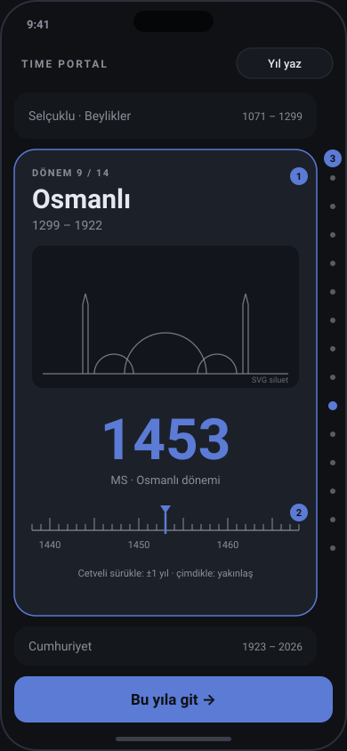

- **Etkileşim:** Her dönem tam ekran bir karttır (`scroll-snap-type: y mandatory`). Kart içinde yatay bir ince ayar cetveli vardır (②): mevcut `Timeline` bileşeni dönem aralığına kilitlenerek kullanılır. Sağda dönem noktaları durur (③).
- **Animasyon:**
  - Kart girişi: ölçek 0,94→1 ve opaklık 0,5→1, kaydırmaya bağlı (`animation-timeline: view()`).
  - Dönem rengi 300 ms'lik çapraz geçişle değişir.
  - Siluet 0,85× hızda paralaks yapar.
  - Yıl değişince 120 ms'lik "sayaç" kayması olur.
  - Reduced motion: snap kalır, diğerleri kapanır.
- **Ölçek hissi:** zayıf. 103 yıllık Cumhuriyet ile 90.000 yıllık Buzul Çağı aynı boydadır. Bu bilgi kaybını "≈ 90.000 yıl" etiketi telafi eder. Kart içinde ölçek doğrusaldır, uzun dönemlerde ise logaritmiktir (mevcut yakınlaştırma).
- **İllüstrasyon:** dönem başına bir SVG siluet (14 adet).
- **Teknik:** CSS scroll-snap ve scroll-driven animations, Firefox için IntersectionObserver yedeği.
- **Emek:** 3–4 gün.
- **Risk:** dikey kaydırma ile yatay cetvel sürüklemesi çakışabilir (çözüm: cetvelde `touch-action: pan-x`). Ölçek hissi kaybolur.

#### Konsept B: Kadran

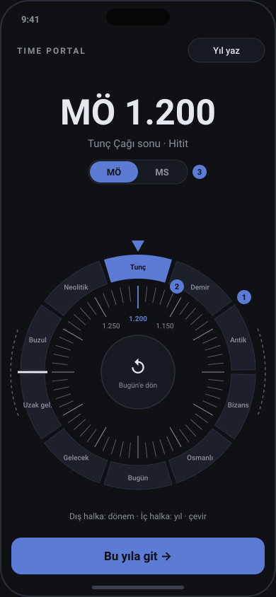

- **Etkileşim:** Başparmakla çevrilir; açı `atan2` ile hesaplanır.
  - Dış halka dönem seçer ve yaylı yapışır (①).
  - İç halka yıl seçer (②).
  - Merkezde "Bugün'e dön" düğmesi var. MÖ/MS anahtarı üstte (③).
  - Uzak gelecek ile Buzul Çağı arasında bir durak çentiği halkayı kapatır.
- **Animasyon:**
  - Atalet: hız her karede ×0,92 azalır.
  - Dönem yapışması: yay (stiffness 300, damping 30, ≈350 ms).
  - Android'de `vibrate(8)` ile dokunsal geri bildirim. iOS Safari `vibrate` desteklemez **(doğrulanmadı)**.
  - Reduced motion: atalet ve yay kapanır.
- **Ölçek hissi:** iyi. İç halkanın bir turu dönem uzunluğuna bağlıdır: bugüne yakın 100 yıl, derin geçmişte 10.000 yıl. Hız farkı parmakla hissedilir.
- **Teknik:** pointer olayları ve react-spring (MIT, 19,6 KB) ya da elle yazılmış yay.
- **Emek:** 5–6 gün.
- **Risk:** keşfedilebilirlik düşük. Masaüstünde fareyle çevirmek yorucu olur (tekerlek desteği gerekir). Kesin yıl seçmek zordur.

#### Konsept C: Höyük kesiti (önerilen)

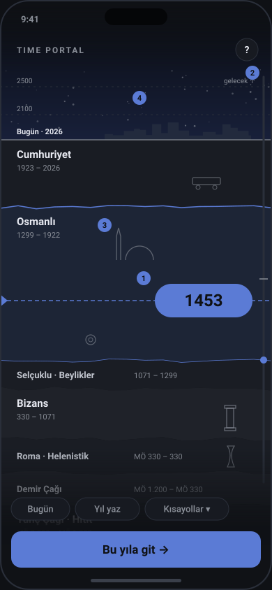
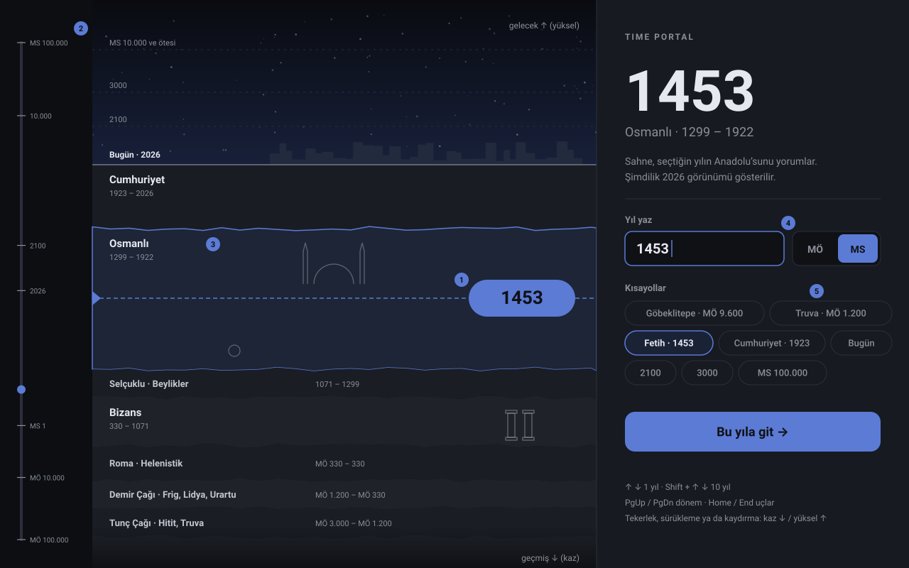

- **Etkileşim:**
  - Sayfa kaydırması yereldir: momentum, erişilebilirlik ve tarayıcının kendi kaydırma çubuğu korunur.
  - Okuma çizgisi (①) sabittir. Aşağısı geçmiş (kazı), yukarısı gelecek (gökyüzü, ④).
  - Derinlik göstergesi (②) tüm aralığı gösterir. Tıklayıp sürükleyerek hızlı atlanır.
  - Katman adları (③) kendi katmanında yapışkandır (`position: sticky`).
  - Masaüstü görselinde sağ panelde yazma alanı (④), kısayollar (⑤) ve klavye ipuçları vardır.
  - Kısayol örnekleri: Göbeklitepe MÖ 9.600, Truva MÖ 1.200, Fetih 1453, Cumhuriyet 1923.
- **Animasyon:**
  - **Giriş (≤1,2 sn, herhangi bir girdiyle atlanır):** yer çizgisi ortadan dışa çizilir (600 ms, `ease-out`). Katmanlar alttan 40 ms arayla yükselir (400 ms, `cubic-bezier(.2,.8,.2,1)`). Yıl hapı 250 ms'de belirir.
  - **Kaydırma:** yıldızlar 0,3× hızda kayar, katmandaki eserler 1,08× hızda (`animation-timeline: scroll()`). Okuma çizgisinin altındaki katman 150 ms'de vurgulanır. Hap değeri `requestAnimationFrame` ile güncellenir, kare başına React render'ı olmaz.
  - **Programatik atlama** (kısayol ya da yazma): "kazı uçuşu", 700–1200 ms, `ease-in-out`. Süre, mesafenin logaritmasıyla artar.
  - **Reduced motion:** giriş ve paralaks yok, atlama anında olur.
- **Ölçek hissi:** güçlü, mevcut `yearToPosition` kullanılır (K=20).
  - Toplam yükseklik ≈12.000 px (mobilde ~14 ekran) olursa çözünürlük şöyle olur **(tahmin, formülden hesaplandı)**:

    | Yıl | Çözünürlük |
    |---|---|
    | Bugüne yakın | ~35 px/yıl |
    | 1453 | ~1,2 px/yıl |
    | MS 1 | ~0,34 px/yıl |
    | MÖ 10.000 | ~17 yıl/px |
    | MÖ 100.000 | ~145 yıl/px |

  - Cumhuriyet, Osmanlı ve Buzul Çağı katmanları ekranda benzer kalınlıktadır (~1.300 px). Bu, logaritmik ölçeği görünür kılar.
  - Canlı bir "1 ekran ≈ N yıl" etiketi gösterilir.
  - Gösterilen yıl kaydırma çözünürlüğüne göre yuvarlanır (derin geçmişte 100'lük). Kesin yıl yazarak girilir.
- **İllüstrasyon:** 14 sade SVG siluet (kubbe, sütun, amfora, sikke, demiryolu, şehir silueti). Kendimiz çizeriz, lisans sorunu olmaz.
- **Teknik:**
  - CSS: sticky, scroll-driven animations ve `svh`/`dvh` birimleri.
  - Firefox'ta scroll-driven animations kararlı sürümde yok (caniuse'a göre 159'da geliyor). Yedek IntersectionObserver ve rAF.
- **Emek:** 5–7 gün.
- **Risk:**
  - Uzun sayfada bellek. Çözüm: katmanlar düz renk ve hafif SVG olur, görsel kullanılmaz.
  - iOS adres çubuğu yükseklik değiştirir. Okuma çizgisi `svh` ile sabitlenmeli.
  - Metafor ilk kez gelen kullanıcıya açıklanmalı: ilk açılışta 2 sn'lik "aşağı kaydır: geçmiş" ipucu.

#### Konsept D: Ufuk ve zaman tüneli (3B)

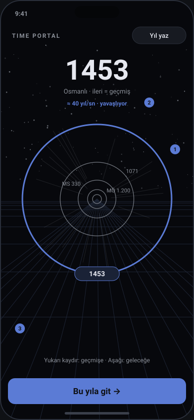

- **Etkileşim:** Kaydırma ve sürükleme hız verir. Kamera zaman ekseninde ilerler: ileri = geçmiş. Dönem sınırları halkalardır (①). Bir halkaya dokununca kamera oraya uçar.
- **Animasyon:**
  - Kamera konumu yaylıdır.
  - Yıldız izlerinin uzunluğu hızla orantılıdır (shader). FOV hıza göre 60°'den 75°'ye açılır.
  - Halkadan geçerken 200 ms parlama olur.
  - Hız göstergesi (②) "≈40 yıl/sn" gösterir. Zemin ızgarası (③) derinlik hissi verir.
- **Ölçek hissi:** hız logaritmiktir. "Hızlanıyor / yavaşlıyor" geri bildirimi etkileyicidir ama hassas seçimde zayıftır.
- **Teknik:** three ve r3f zaten var. Ancak bu parça (244 KB gzip, **ölçüldü**) ilk ekranda yüklenmek zorunda kalır. İlk JS yükü 76 KB'tan yaklaşık 320 KB'a çıkar.
- **Emek:** 8–10 gün.
- **Risk:**
  - Hareket hastalığı (vestibüler).
  - Pil ve ısınma.
  - WebGL olmayan cihazlarda yedek gerekir.
  - Ekran okuyucu için ayrı bir DOM katmanı gerekir.
  - Reduced motion'da tamamen statik listeye dönülmesi gerekir.

#### Karşılaştırma (1 = zayıf, 5 = güçlü)

| Ölçüt | A Kartlar | B Kadran | **C Höyük** | D Uzay |
|---|---|---|---|---|
| Mobilde kolaylık | 4 | 3 | **5** | 3 |
| Erişilebilirlik | 4 | 3 | **5** | 2 |
| Doğrusal olmayan ölçek hissi | 2 | 4 | **5** | 4 |
| Akılda kalıcılık | 3 | 4 | **4** | 5 |
| Performans ve paket boyutu | 5 | 4 | **5** | 2 |
| Mevcut kodla uyum (`scale.ts`, `Timeline`) | 4 | 2 | **5** | 3 |
| Emek (gün) | 3–4 | 5–6 | **5–7** | 8–10 |

**İkon ve illüstrasyon kaynakları:**

| Kaynak | Lisans | Kullanım |
|---|---|---|
| Phosphor Icons | MIT | Arayüz ikonları (önerilen) |
| Tabler Icons | MIT | Arayüz ikonları (alternatif) |
| Lucide | ISC **(doğrulanmadı: GitHub API lisansı tanımlayamadı)** | Arayüz ikonları |
| game-icons.net | CC BY 3.0 (bazıları CC0) | Tarihî nesneler; **atıf zorunlu** |
| OpenMoji | CC BY-SA 4.0 | Paylaşım yükümlülüğü var, önerilmez |
| The Met Open Access, Smithsonian Open Access | CC0 | Gerçek eser fotoğrafları; ileride dönem kartı arka planı |
| Wikimedia Commons | Kamu malı (PD) | Eski haritalar ve gravürler; dosya bazında kontrol edilmeli |

---

### 4. Harita sayfası

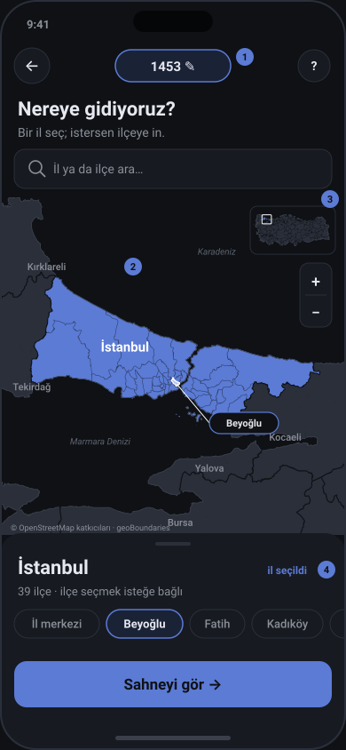
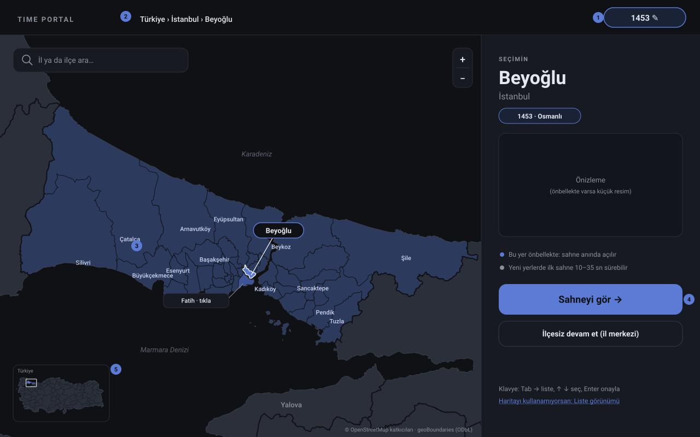

*Wireframe'lerdeki sınırlar depodaki `districts.txt`ten gerçek veriyle çizildi (© OpenStreetMap katkıcıları, geoBoundaries, ODbL). İl ve ilçe sınırları kenar komşuluğundan çıkarıldı.*

**Yerleşim:**
- Üstte geri düğmesi ve **yıl rozeti** (①). Rozete dokunmak yıl ekranına döner.
- Arama alanı ("İl ya da ilçe ara…").
- Harita (②): seçilen il açık lacivert, diğerleri gri, il sınırları koyu çizgi.
- Mini harita (③) ve alt sayfa (④): il adı, ilçe sayısı (İstanbul: 39, **ölçüldü**), ilçe çipleri ve "Sahneyi gör".
- Masaüstünde sağ panel: seçim kartı, önizleme küçük resmi (önbellekte varsa), önbellek bilgisi, "İlçesiz devam et (il merkezi)" ve bir liste görünümü bağlantısı.

**İl ve ilçe seçeneği:**

| Seçenek | Akış | Artı | Eksi |
|---|---|---|---|
| A. Yalnızca il | il → sahne (il merkezi) | En basit, 81 hedef | Backend'in ilçe düzeyindeki görsel çeşitliliği (karar #37) kullanılmaz |
| B. İl → ilçe zorunlu | il → yakınlaş → ilçe → sahne | Kesin | Bir adım fazla. Beyoğlu gibi küçük ilçeler mobilde ~8 px |
| **C. İl → ilçe isteğe bağlı (öneri)** | il → yakınlaş (ilçe sınırları belirir) → "Sahneyi gör" ya da ilçe seç | İki kullanıcı tipine de uyar | Alt sayfa iki durumu açık anlatmalı |

**Teknik:**
- **Taban karo yok (öneri):** koyu zemin üzerinde yalnızca bizim poligonlarımız. Bu, OpenFreeMap bağımlılığını (#27) ve karo yükünü kaldırır. Görünüm sahne ve yıl ekranıyla tutarlı olur. ODbL atfı gene görünür kalmalı.
- **MapLibre katmanları:** `fill` katmanında `feature-state` (selected/hover) ile renk ifadesi, `line` katmanında il ve ilçe sınırları.
- **Yakınlaşma:** ile tıklayınca `fitBounds` (600 ms, alt sayfa yüksekliği kadar `padding`). Reduced motion'da `duration: 0`.
- **Veri boyutu:** tüm ilçeler GeoJSON olarak **333–500 KB gzip (ölçüldü)**. Bu yüzden veri bölünmeli:
  - İl katmanı TopoJSON olarak gelir (**tahmin: 60–120 KB gzip**).
  - Seçilen ilin ilçeleri tembel yüklenir: `/geo/34.json`, il başına birkaç KB **(tahmin)**.
  - Dosyalar derleme zamanında `districts.txt`ten mapshaper (MPL-2.0) ile üretilir. İstemcide `topojson-client` (ISC, 2,5 KB) kullanılır.
- **Sahne isteği:** tıklanan nokta yerine **ilçe ya da il merkezinin koordinatıyla** gider. Aynı yer her zaman aynı isteği üretir, önbellek isabeti artar.
- **Erişilebilirlik:** harita klavyeyle zor kullanılır. Eşdeğer yol:
  - Combobox arama. Türkçe büyük/küçük harf için `toLocaleLowerCase('tr')`, aksan duyarsız eşleşme.
  - "Liste görünümü": 81 il, altında ilçeler.
  - `aria-live` duyurusu: "İstanbul seçildi, 39 ilçe".
- **Mobilde dokunma hedefi:** Türkiye 390 px genişlikte yaklaşık 374×150 px kaplar. Küçük iller (Yalova, Kilis) 10 px'in altına düşer **(tahmin)**. Bu yüzden mobilde aramayı öne çıkarmak gerekir.

---

### 5. Sahne sayfası ve yükleme durumu

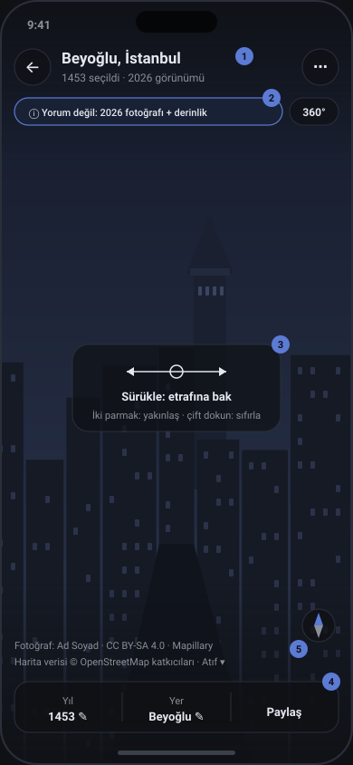
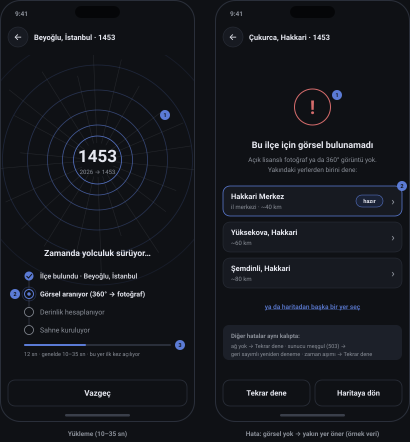

**Tam ekran:**
- `position: fixed; inset: 0; height: 100dvh`, kenarlarda `env(safe-area-inset-*)` boşlukları.
- **Fullscreen API düğmesi** yalnızca masaüstü, Android ve iPad'de gösterilir. iPhone Safari öğe tam ekranını desteklemiyor: WebKit kaydı WONTFIX, Haziran 2026 tarihli bir yoruma göre Safari 27 betasında da yok **(doğrulanmadı, ikincil kaynak)**. Mevcut `fullscreenSupported()` kontrolü bunu zaten karşılıyor.

**Katmanlar:**
- **Üst katman (①):** geri, "Beyoğlu, İstanbul", "1453 seçildi · 2026 görünümü", menü (⋯).
- **Not çipi (②):** MVP'de "Yorum değil: 2026 fotoğrafı + derinlik". Faz 3 üretiminde "Yapay zekâ yorumu, tarihsel belge değil". Metin açık karar listesinde ("tarihsel doğruluk uyarısı").
- **360° ya da 2.5B rozeti.**
- **Jest ipucu (③):** ilk açılışta 3 sn görünür ya da ilk sürüklemede kaybolur.
- **Alt çubuk (④):** "Yıl 1453 ✎", "Yer Beyoğlu ✎", "Paylaş".
- **Atıf (⑤):** her zaman görünen tek satır. "Atıf ▾" mevcut `Attribution` bileşenini açar.
- **Pusula:** bakış yönü. Dokununca sıfırlanır.
- **Katmanları gizleme:** boş alana dokununca katmanlar gizlenir ya da gösterilir (fotoğraf görüntüleyicilerdeki gibi). 4 sn hareketsizlikte soluklaşırlar, reduced motion'da anında.

**Jestler:**
- Tek parmak: bak.
- Çimdik: yakınlaş.
- Çift dokunuş: sıfırla.
- İki parmakla sürükleme: ileride derinlikli hareket (#5).
- Jiroskop sonraya kalır: iOS'ta `DeviceOrientationEvent.requestPermission()` izni gerekir.

**Paylaş:**
- Web Share API: iOS 12.2+, Chrome 128+, Edge 95+. Firefox masaüstünde yok.
- Yedek: "Bağlantıyı kopyala".
- Bağlantı: `/yil/1453/yer/34-beyoglu/sahne`.

**Yükleme tasarımı:**
- **Animasyon:** CSS ile 4 eş merkezli halka. Her biri 0,6→1,6 ölçek ve opaklıkla 1,6 sn'de, kaydırmalı başlangıçla döner. Three.js gerekmez. Merkezdeki sayaç ilk 1,5 sn'de 2026'dan hedef yıla akar (`ease-out`), sonra sabit kalır.
- **WCAG 2.2.2 uyumu:** sayfada "Vazgeç" düğmesi olduğu için ön yükleme istisnası tam uymayabilir. Bu yüzden halkalar 5 sn sonra durgun "nefes" moduna geçer, yalnızca ilerleme çizgisi hareket eder. Reduced motion'da tamamen statik.
- **Aşamalar:** "İlçe bulundu" → "Görsel aranıyor (360° → fotoğraf)" → "Derinlik hesaplanıyor" → "Sahne kuruluyor".
  - API bugün yalnızca `PENDING/RUNNING` döndürüyor (`api/scenes.ts`). `Scene` yanıtına `stage: LOCATING | IMAGE_SEARCH | DEPTH | PACKAGING` alanı eklenmeli (küçük bir backend işi ve `docs/API.md` değişikliği). Alan yoksa yalnızca geçen süre gösterilir, sahte aşama gösterilmez.
  - Aşama listesi `role="status"` ile duyurulur.
- **Süre bilgisi:**
  - "12 sn · genelde 10–35 sn".
  - 35 sn'den sonra "Beklenenden uzun sürüyor".
  - Mevcut zaman aşımı 120 sn.
  - Önbellekteki sahne için yükleyici **300 ms gecikmeli** gösterilir, ekran yanıp sönmez.
- **Vazgeç:** mevcut `AbortController` isteği iptal eder ve haritaya döner, seçim korunur. Backend işi sürer, sonucu önbelleğe girer. Bu bir avantajdır.

**Hata durumları:**

| Durum | Ekran | Eylem |
|---|---|---|
| Görsel bulunamadı | "Bu ilçe için görsel bulunamadı" ve en yakın 3 yer (önbellekteyse "hazır" rozeti) | Öneriye git · Haritaya dön · Tekrar dene |
| Ağ yok | "Sunucuya ulaşılamadı" | Tekrar dene |
| 503, sunucu meşgul | "Sunucu meşgul, N sn sonra yeniden denenecek" | Retry-After'a göre geri sayım (#33) |
| Zaman aşımı | "Üretim çok uzun sürdü" | Tekrar dene |
| WebGL yok | Düz önizleme (mevcut) | Yok |

Yakın yer önerisi için ilçe komşulukları `districts.txt`ten çıkarılabilir; bu çalışmada kenar komşuluğu zaten hesaplandı. Görsel zinciri zaten il merkezi fotoğrafına düştüğü için (#40) bu hata seyrek olmalı **(tahmin)**.

---

### 6. Yönlendirme ve geçişler

| Seçenek | Lisans | Boyut (bundlephobia, tam paket, gzip) | Artı | Eksi |
|---|---|---|---|---|
| **React Router v8, declarative mod (öneri)** | MIT | 62,2 KB (kullanılan kısım çok daha az; **ölçülmedi**) | Yaygın, basit `BrowserRouter` + `Routes`. v8.5 kendi view transition API'lerini React `<ViewTransition>` lehine kullanımdan kaldırıyor, yani React ile uyumlu | Paket büyük görünüyor |
| TanStack Router | MIT | 30,3 KB | Tip güvenli parametreler, `defaultViewTransition`, yöne göre geçiş türü | Üç sayfa için fazla |
| Durum makinesi + History API | Yok | 0 | Bağımlılık yok | Geri tuşu, derin bağlantı ve kaydırma geri yüklemesi elle yazılır |

**URL tasarımı:**
```
/                                   yıl seçimi (son yıl localStorage'dan)
/yil/1453                           harita; MÖ için /yil/mo-1200 (-1200 de kabul edilir, yönlendirilir)
/yil/1453/yer/34                    il seçili (plaka kodu; 81 kayıtlık tablo eklenmeli)
/yil/1453/yer/34-beyoglu            ilçe seçili (ASCII slug; "Merkez" → 30-merkez)
/yil/1453/yer/34-beyoglu/sahne      sahne (paylaşılan bağlantı)
```

İlçe adları il içinde benzersiz (yinelenen yok, 51 il "Merkez" ilçesine sahip, **ölçüldü**). Bu yüzden `plaka-slug` biçimi yeterli. İş (job) kimliği URL'ye girmez: (yıl, yer) belirleyici bir anahtardır ve önbellekle birlikte yeterlidir. Barındırmada SPA yedeği gerekir (bilinmeyen yol → `index.html`). Barındırma kararı açık.

**Geri tuşu:**
- Sayfa değişimi `push`, harita içindeki seçim değişimi `replace`. Böylece geri tuşu her tıklamayı tek tek geri almaz.
- Sahnedeki "←" haritaya döner, seçim korunur. Kullanıcı derin bağlantıyla geldiyse (React Router'da `location.key === 'default'`) "←" `history.back()` yerine üst rotaya `replace` eder, siteden çıkmaz.
- Yükleme sırasında geri tuşu üretimi iptal eder.
- Yıl ekranına dönüşte giriş animasyonu oynamaz. `history.scrollRestoration = 'manual'` kullanılır, kaydırma konumu yıldan hesaplanır.

**View Transitions:**
- **Destek:** aynı belge içi geçişler Chrome 111+, Safari 18+ ve Firefox 144+ ile Ekim 2025'te Baseline oldu. Küresel kullanım %92,9 (caniuse).
- **React:** 19.3'te `<ViewTransition>` ve `addTransitionType` kararlı.
  - Yön için `addTransitionType('ileri' | 'geri')` kullanılır.
  - Desteklemeyen tarayıcıda anında güncelleme beklenir **(doğrulanmadı)**.
  - React yazısı reduced-motion'dan söz etmiyor. CSS'te `@media (prefers-reduced-motion: reduce)` içinde `::view-transition-*` animasyonları kapatılmalı.
- **Paylaşılan öğe:** yıl hapı → yıl rozeti (`name="yil-rozeti"`).
- **İl şeklinin sahneye büyümesi:** il şekli MapLibre canvas'ında olduğu için doğrudan paylaşılamaz. Geçiş anında seçili ilin SVG kopyası çizilip tam ekrana büyütülür **(deneysel)**. WebGL canvas'ın geçiş anlık görüntüsü **test edilmeli**.

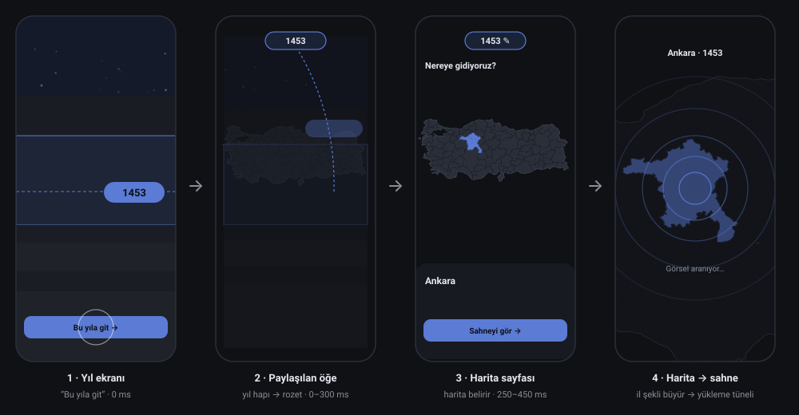

| Geçiş | Ne hareket eder | Süre, easing | Reduced motion |
|---|---|---|---|
| Yıl → harita | Yıl hapı üstte rozete dönüşür. Kesit 0,92× küçülür, 24 px aşağı kayar ve solar. Harita 1,04→1 ölçekle belirir | 350–450 ms, `cubic-bezier(.2,.8,.2,1)` | 150 ms çapraz soldurma |
| İl seçimi | `fitBounds` yakınlaşması, alt sayfa yukarı kayar | 600 ms / 250 ms | Anında |
| Harita → sahne | İl veya ilçe sınırı büyür, tünel halkaları başlar | 500 ms, `ease-in-out` | Anında |
| Yükleme → görüntüleyici | `clip-path: circle()` ile merkezden açılır | 600 ms, `ease-out` | 150 ms soldurma |
| Geri | Aynı geçişler ters yönde | Aynı | Aynı |

---

### 7. Teknik seçimler

| İhtiyaç | Seçim | Lisans | Boyut (gzip) | Gerekçe |
|---|---|---|---|---|
| Yönlendirme | React Router v8 | MIT | ≤62,2 KB (tam paket) | Basit, URL ve geri tuşu hazır |
| Sayfa geçişi | React `<ViewTransition>` + View Transitions API | MIT / platform | 0 (React'te var) | 19.3'te kararlı, Baseline |
| Kaydırma animasyonu | CSS `animation-timeline` + IntersectionObserver yedeği | Platform | 0 | Ana iş parçacığı dışında çalışabilir (Chrome). Safari 26+, Firefox kararlıda yok |
| Mikro animasyon | CSS + WAAPI; gerekirse Motion `useAnimate` | MIT | 3,3 KB (mini) | `motion` bileşeni ~43 KB, gereksiz |
| Yay fiziği (yalnızca B) | react-spring | MIT | 19,6 KB | Kadranın ataleti |
| (Önerilmez) | GSAP 3.15 | "Standard No Charge" (Webflow, OSI değil) | 26,7 KB | Ücretsiz ama özel lisans. Rakip görsel araçlarda yasak, Webflow lisansı değiştirebilir |
| 3B (yalnızca D) | three + r3f (mevcut) | MIT | 244 KB (**ölçüldü**, mevcut parça) | İlk ekrana taşınması pahalı |
| Harita | MapLibre GL JS (mevcut) | BSD | 283,5 KB (**ölçüldü**) | Zaten tembel yükleniyor |
| Sınır verisi | TopoJSON + `topojson-client` | ISC | 2,5 KB + veri | Paylaşılan kenarlar küçük dosya demek |
| Veri hazırlama | mapshaper (yalnızca derlemede) | MPL-2.0 | 0 | Sadeleştirme ve TopoJSON |
| İkon | Phosphor | MIT | İkon başına <1 KB | |

Mevcut parçalar (**ölçüldü**, `vite build`): ana parça 76 KB, harita 283,5 KB, görüntüleyici 244 KB gzip. Konsept C ana parçaya CSS ve birkaç KB SVG ekler (**tahmin: +10–20 KB**). Harita ve görüntüleyici tembel kalır. Yıl ekranındayken harita parçası `<link rel="prefetch">` ile boşta indirilebilir.

**60 fps hedefi:** yalnızca `transform` ve `opacity` canlandırılır. Hap değeri DOM'a doğrudan yazılır. Uzun kesitte katmanlar düz renk olur, yıldızlar tek bir SVG'dir. `will-change` yalnızca hareket eden 2–3 öğede kullanılır.

---

### 8. Referans görseller

Tüm görsel bağlantıları 25.10.2026'da `curl` ile denendi ve HTTP 200 ile görsel içerik türü döndürdü. Kapak/logo notu düşülenler hariç hepsi içerik açısından da gözle incelendi.


*ChronoZoom (Microsoft Research ve UC Berkeley): iç içe dönem kutuları ve üstte ölçek çubuğu. Derinlik göstergesine ilham. Commons, CC0. Doğrulandı.*


*Histropedia: yakınlaştırılabilir, görsel kartlı zaman çizgisi. Commons, CC BY-SA 4.0. Doğrulandı.*


*TimelineJS (Knight Lab, kütüphane MPL-2.0): yatay eksende olay kartları. Görsel Knight Lab'e ait, yalnızca referans. Doğrulandı.*


*TiddlyWiki içinde vis-timeline (kütüphane Apache-2.0 / MIT ikili lisans). Commons, CC BY-SA 4.0. Doğrulandı.*


*Logaritmik eksende uzak gelecek (1–10.000 milyar yıl). Bizim geleceğe uzanan ölçeğimize örnek. Commons, CC BY-SA 4.0. Doğrulandı.*


*Kozmik Takvim: derin zamanı tanıdık bir birime (bir yıla) sıkıştırır. "1 ekran ≈ N yıl" fikrinin kaynağı. Commons, CC BY-SA 3.0. Doğrulandı.*


*Jeolojik saat: kadran (Konsept B) için referans. Commons, kamu malı. Doğrulandı.*


*Jeolojik zaman sarmalı (USGS): katman ve derinlik metaforu (Konsept C ve D). Commons, kamu malı. Doğrulandı.*


*Vikipedi'nin dikey hominin zaman çizelgesi: renkli dönem bantları ve sağda olaylar. Dikey kesitin sade bir örneği. Commons, CC BY-SA 4.0. Doğrulandı.*


*Müze duvar zaman çizelgesi (Addis Ababa). Fiziksel sergide ölçek ve etiket dengesi. Adam Jones, CC BY-SA 2.0. Doğrulandı.*


*Histography (Matan Stauber): Vikipedi olaylarını noktalar hâlinde gösteren etkileşimli zaman çizgisi. Bu görsel yalnızca sitenin kapağı ve logosu, etkileşim için siteye bakılmalı. Telif sahibine ait. Görsel döndü, içerik bir arayüz görüntüsü değil.*

Google Arts & Culture zaman çizgileri ve Awwwards'taki kaydırma animasyonlu siteler için açık lisanslı ve doğrulanabilir bir görsel bağlantısı bulunamadı. Bu yüzden eklenmedi.

---

### 9. Öneri ve emek tahmini

Konsept C'yi öneriyorum, üç nedenle:
- **Erişilebilirlik ve performans:** yerel kaydırmaya dayandığı için ikisi de en iyi düzeyde. Ekran okuyucu ve klavye için ayrı bir dünya kurmak gerekmez.
- **Ölçek:** logaritmik ölçeği gizlemeden gösterir. Katman kalınlıkları ve "1 ekran ≈ N yıl" etiketi bu işi yapar.
- **Ürün kimliği:** höyük, Türkiye kapsamına özgü bir metafor. Masaüstünde de doğal ölçeklenir.

Konsept A en ucuz yedek. B ve D'nin parçaları (atalet, "zaman tüneli") yükleme ekranında ve ileride kullanılabilir.

| İş | MVP | Gün (tahmin) |
|---|---|---|
| Yönlendirme, URL, geri tuşu, 3 sayfa iskeleti | ✔ | 2 |
| Yıl ekranı C: katmanlar, okuma çizgisi, gösterge, yazma, kısayollar, klavye | ✔ | 4 |
| C animasyonları (giriş, paralaks, kazı uçuşu) ve reduced motion | ✔ | 1,5 |
| 14 dönem silueti (SVG) ve dönem verisi | ✔ | 1 |
| Harita: poligon verisi (il TopoJSON + ilçe parçaları), il → ilçe, alt sayfa, arama | ✔ | 3,5 |
| Sahne tam ekran: katmanlar, ipucu, paylaş, atıf | ✔ | 1,5 |
| Yükleme ekranı ve backend `stage` alanı | ✔ | 1,5 |
| View Transitions (yıl rozeti), testler | ✔ | 1 |
| **MVP toplam** | | **≈16 (aralık 13–17)** |
| Liste görünümü (harita alternatifi), yakın yer öneri uç noktası | Sonra | 2 |
| İl şeklinin sahneye büyümesi (SVG kopyası) | Sonra | 1,5 |
| Dokunsal geri bildirim, jiroskop | Sonra | 1 |
| Dönem kartlarına CC0 müze görselleri | Sonra | 2 |
| Konsept D (3B tünel), deneysel mod olarak | Sonra | 8–10 |

---

### 10. Sahibinin vereceği kararlar

Her biri ayrı bir `karar` issue'su olabilir. Öneriler ★ ile işaretli.

1. **Yıl ekranı konsepti:** A Dönem kartları · B Kadran · **C Höyük kesiti ★** · D 3B uzay
2. **Yön metaforu (C için):** **A aşağı = geçmiş, yukarı = gelecek ★** · B ters yön
3. **İl ve ilçe seçimi:** A yalnızca il · B il → ilçe zorunlu · **C il → ilçe isteğe bağlı ★**
4. **Harita zemini:** **A taban karo yok, yalnızca il ve ilçe poligonları ★** · B soluk OpenFreeMap zemini (#27) · C ikisi arasında anahtar
5. **Yönlendirme:** **A React Router v8 ★** · B TanStack Router · C kendi durum makinemiz
6. **MÖ yılının URL'deki yazımı:** **A `/yil/mo-1200` ★** · B `/yil/-1200`
7. **Yükleme aşamaları:** **A backend'e `stage` alanı eklensin ★** · B yalnızca geçen süre gösterilsin
8. **Dönem etiketleri:** A Anadolu geneli (bu belgedeki 14 bant) · **B Anadolu geneli; sahnede il bazında düzeltme ★** · C il bazında, yıl ekranında da

---

### 11. Kaynaklar

Hepsine 25.10.2026'da erişildi.

- GSAP lisansı: https://webflow.com/blog/gsap-becomes-free · https://gsap.com/community/standard-license/
- View Transitions Baseline: https://web.dev/blog/same-document-view-transitions-are-now-baseline-newly-available · https://caniuse.com/view-transitions
- Scroll-driven animations: https://developer.chrome.com/docs/css-ui/scroll-driven-animations · https://caniuse.com/mdn-css_properties_animation-timeline
- React 19.3 `<ViewTransition>`: https://react.dev/blog/2026/09/09/react-19-3 · https://react.dev/blog/2025/04/23/react-labs-view-transitions-activity-and-more
- React Router v8 (arama özetinden, sayfalar doğrudan açılmadı): https://reactrouter.com/8.0.0/changelog.md · https://app.unpkg.com/react-router@8.5.0/files/CHANGELOG.md
- TanStack Router: https://tanstack.com/router/v1/docs/framework/react/api/router/NavigateOptionsType · https://tanstack.com/router/latest/docs/framework/react/examples/view-transitions
- Motion: https://motion.dev/docs/react-reduce-bundle-size · https://motion.dev/docs/gsap-vs-motion
- Paket boyutları: https://bundlephobia.com/api/size?package=… (react-router 8.5.0, @tanstack/react-router 1.170.46, motion 14.6.0, gsap 3.15.0, @react-spring/web 10.1.2, three 0.186.1, topojson-client 3.1.0)
- Fullscreen ve iPhone: https://caniuse.com/fullscreen · https://developer.apple.com/forums/thread/133248 · https://bugs.webkit.org/show_bug.cgi?id=240312 (WONTFIX kaydı arama özetinden, **doğrulanmadı**)
- Web Share: https://caniuse.com/web-share
- WCAG 2.2.2: https://www.w3.org/WAI/WCAG22/Understanding/pause-stop-hide.html
- ARIA slider deseni: https://www.w3.org/WAI/ARIA/apg/patterns/slider/ (genel başvuru)
- Lisanslar (GitHub): phosphor-icons/core, tabler/tabler-icons (MIT) · game-icons/icons license.txt (CC BY 3.0) · hfg-gmuend/openmoji (CC BY-SA 4.0) · NUKnightLab/TimelineJS3 (MPL-2.0) · visjs/vis-timeline (LICENSE.Apache-2.0.txt + LICENSE.MIT.txt) · topojson/topojson-client (ISC) · mbloch/mapshaper (MPL-2.0) · maplibre/maplibre-gl-js (BSD)
- Açık erişim müze koleksiyonları: https://www.metmuseum.org/openaccess · https://www.si.edu/openaccess
- Görseller: https://commons.wikimedia.org (her dosyanın sayfası görsel URL'sinden türetilebilir) · https://histography.io · https://timeline.knightlab.com
- Proje: `docs/DURUM.md`, `frontend/src/timeline/scale.ts`, `frontend/src/api/scenes.ts`, `backend/src/main/resources/geo/README.md`

