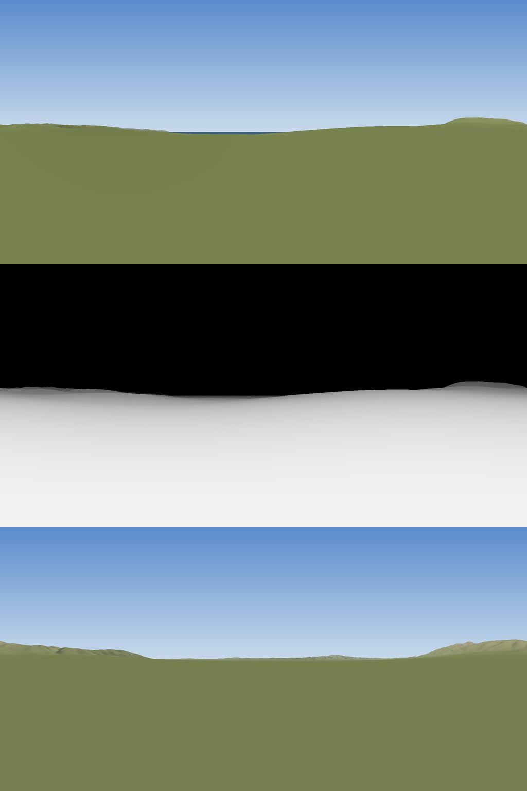
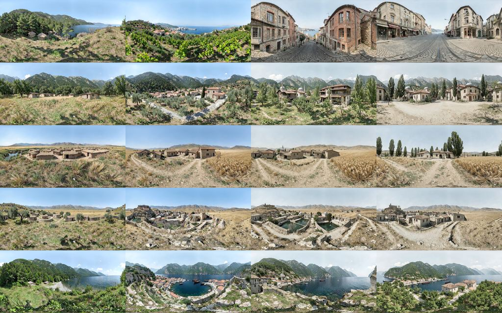
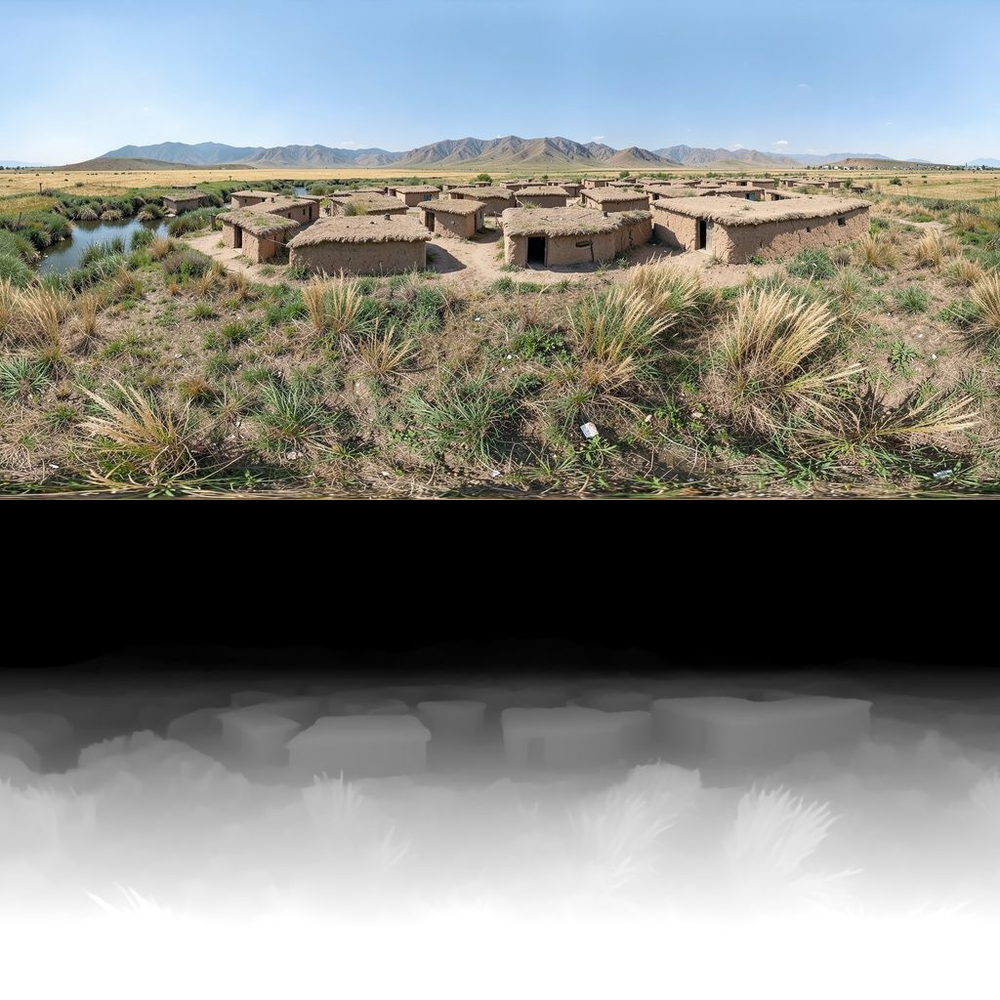
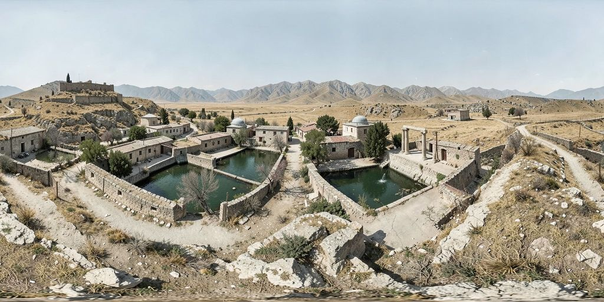
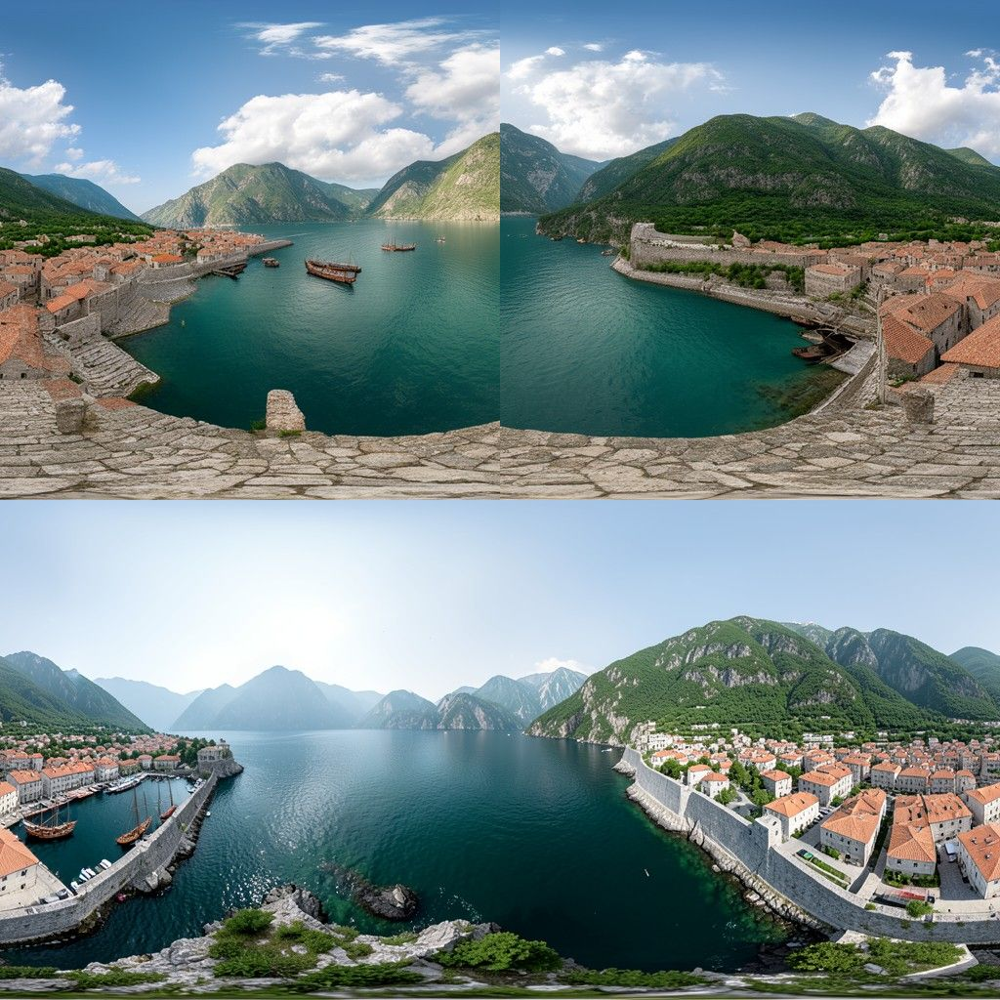
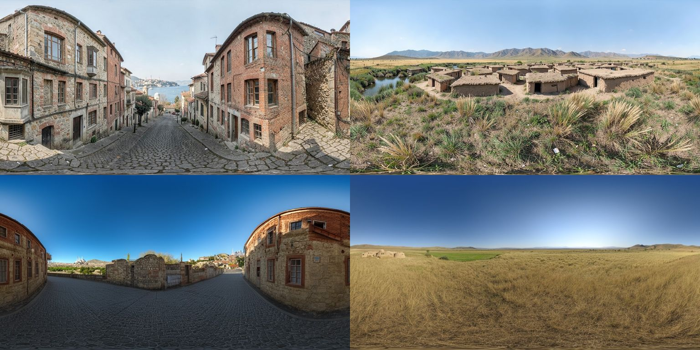

# Üretim pilotu raporu (#67)

Tarih: 25.10.2026 · Makine: Mac mini, Apple M2, 8 GB birleşik bellek, 10 çekirdekli GPU (MLX/Metal) ·
Kararlar: 5A (karma yol), 6A (20 sahnelik pilot) · Araştırma: `docs/arastirma/faz2-arastirma-raporu.md` bölüm B.

Betikler `backend/tools/pilot/` altında. Model ağırlıkları `~/.cache/time-portal/pilot/`, üretilen görseller
`~/time-portal-pilot/` altında (depo dışı). Depoda yalnızca küçültülmüş örnekler var (`docs/pilot/img/`).

İşaretler: **[Ölçüm]** bu pilotta ölçüldü · **[Tahmin]** hesap ya da çıkarım · **[Gözlem]** görsel değerlendirme.

---

## Adım 0: kurulum ve ilk ölçüm

### Kurulum

| Adım | Not |
|---|---|
| Python | Sistemdeki Homebrew Python 3.15'te `mflux` kurulamıyor (bağımlılıklardan birinin 3.15 tekerleği yok, pip çözümleyici `ResolutionImpossible`). `uv` ile depo dışına (`~/.cache/time-portal/pilot/python`) Python 3.12.15 kuruldu; venv `backend/tools/pilot/.venv` (gitignore'da). |
| Pillow | `mflux` en yeni Pillow 13'ü çekiyor; Pillow 13, Python 3.12.15'te `numbers._IntegralLike` içe aktarma hatası veriyor. `pillow>=12.3,<13` sabitlendi. |
| Paketler | `mflux 0.23.0` (MIT), `mlx 0.32.4`, `onnxruntime 1.31.0`, `pytest`. Liste: `backend/tools/pilot/requirements.txt`. |
| Modeller | `setup_models.sh`: `mflux-save --quantize 4` ile klein **base** 4B ve klein 4B (damıtılmış) 4-bit kopyaları, her biri 4,3 GB. İndirme + dönüştürme base için 34 dk (çoğu indirme), damıtılmış için 3 dk (metin kodlayıcı ortak); tepe bellek 5,85 GB [Ölçüm]. Ham bf16 indirme önbelleği 22 GB (silinebilir). |
| LoRA | `nomadoor/flux-2-klein-4B-360-erp-outpaint-lora` (commit `124129f`), `hf_hub_download` ile önbelleğe. |

### İlk görüntü ve ayarlama (1024×512, Trabzon × Roma)

LoRA bir "düzenleme" LoRA'sı: 2:1 yeşil (#00ff00) kontrol görüntüsünde yeşil alanları 360° olarak dolduruyor.
Pilotta kontrol tamamen yeşil (yalnızca metinden 360°). LoRA kartının iş akışı: **base** model, 20 adım, CFG 5,
LoRA 0,9. Süre ve bellek `/usr/bin/time -l` ile (bellek: "peak memory footprint"; MLX belleği `ru_maxrss`'e
yansımıyor, o yüzden kullanılmadı).

| # | Ayar | Süre | Adım başına | Tepe bellek | Dikiş oranı | Dikiş sırası |
|---|---|---|---|---|---|---|
| 1 | base + LoRA (gömülü), 20 adım, CFG 5 | 852 s | 42 s | **9,75 GB** (takas) | 4,60 ✗ | 1,00 ✗ |
| 2 | + fp16 hesap, metin kodlayıcı serbest, MLX önbellek 1 GB (4 adımlık hız denemesi) | 127 s | 31 s | 6,43 GB | — | — |
| 3 | + yarım boy kontrol (512×256), gizli değişken döndürme, 20 adım | 424 s | 21 s | 6,40 GB | 2,19 ✗ | 1,00 ✗ |
| 4 | **damıtılmış** klein 4B + LoRA, 4 adım, CFG yok, + sarmalı dolgulu VAE çözme | **46 s** | 11 s | 6,87 GB | **0,42 ✓** | 0,05 ✓ |
| 5 | 4 numara, **2048×1024** | 224 s | 44 s | 9,78 GB (takas) | 1,32 ✓ | 0,98 |

[Ölçüm, hepsi]. Bulgular:

- **8 GB'ta sığıyor**, ama 2048×1024'te ve ilk ayarda tepe bellek fiziksel belleği aşıyor (takas). Uygulama
  sunucuları (8081, 5174) açıkken ölçüldü.
- En büyük hız kazançları: `compute_precision=float16` (M2'de bf16 yavaş), metin kodlayıcıyı tarifler kodlandıktan
  sonra bellekten atmak (Qwen3 4B, ~2,2 GB), referans (kontrol) görüntüsünü yarım boy vermek (jeton sayısı ¼).
- **Base model (LoRA kartının önerisi) 1024×512'de bile sahne başına 7 dk**; 2048×1024'te ~30 dk+ [Tahmin].
  Damıtılmış model kartın uyarısına ("çoğu durumda iyi sonuç vermez") rağmen bu pilotta **daha temiz** sonuç verdi
  (bkz. Adım 2) ve 2048×1024'te sahne başına 3,7 dk.
- LoRA'yı 4-bit katmanlara "gömmek" (varsayılan) güncellemenin yalnızca %73'ünü koruyor (mflux uyarısı);
  `--no-bake` ile tamamı uygulanıyor, hız farkı ölçülemeyecek kadar küçük.
- 20 adım + CFG ile denenen base modelde sağ–sol kenar kopuk kaldı (dikiş oranı > 2). İki düzeltme eklendi:
  1. **Gizli değişken döndürme** (her adımdan sonra yatay `roll`, çözmeden önce geri alınır): tek başına yetmedi.
  2. **Sarmalı dolgulu VAE çözme**: gizli değişken iki yandan 4 sütun (64 px) sarmalı dolguyla çözülüp kırpılıyor.
     Asıl kopukluk VAE çözücüsünün sıfır dolgusundan geliyormuş; bu düzeltmeden sonra dikiş oranı 0,4–1,3.

### Dikiş ölçütü

`depthmath.seam_ratio` backend'deki `DepthMath.seamRatio` ile birebir aynı (sol/sağ kenar sütun farkı ortalaması /
iç komşu sütun farkı ortalaması, kabul ≤ 2). Pilotta bir zayıflığı görüldü: oran tek bir ortalamaya bölündüğü için
keskin ayrıntılı ama **kusursuz sürekli** bir görüntüde de 2'yi aşabiliyor (ışın izlenmiş Beyoğlu arazi derinliğinde
oran 5,07; iç sütun çiftlerinin %1'i zaten 10'un üstünde). Bu yüzden ikinci bir ölçüt eklendi:
**`seam_rank`** = dikiş farkının, aynı görüntünün iç komşu sütun çiftleri arasındaki yüzdelik sırası. Sürekli
dikişte tipik bir değer, kopuk dikişte ~1. `pole_ratio` = üst/alt %3 şeritteki yatay komşu farkı / tüm görüntününki
(ERP'de kutup satırı tek nokta; küçük = temiz). Testler: `backend/tools/pilot/tests/` (`pytest`, sentetik veri).

---

## Adım 1: arazi panoraması ve hesaplanmış derinlik

`backend/tools/pilot/terrain.py`. Kaynak: AWS Terrain Tiles, Terrarium PNG (anahtarsız; SRTM/GMTED/ETOPO1, kamu
malı, atıf gerekir). z = 11 (~58 m/piksel enlem 41°'de), yarıçap 45 km, yer başına 36–42 karo (5 yer toplam 287
karo, 21 MB önbellek).

**Yöntem:** göz yerden 1,7 m. Her ERP sütunu bir azimut (orta sütun = kuzey, sağa doğru saat yönü), her satır bir
yükseklik açısı. Işın boyunca 2.020 yatay mesafe örneği (1 m – 2 km geometrik, sonra 25 m adım), yükseklik bilinear
örneklenir, dünya eğriliği ve standart kırılma (k = 0,13) düşülür. Birikimli en büyük yükseklik açısı satır açısını
ilk aştığı yerde ışın çarpar (iki örnek arası doğrusal ara değer); aşmazsa gökyüzü. Deniz (yükseklik ≤ 0) düz su
yüzeyi sayılır ve maskede ayrı işaretlenir. Çıktılar: `depth_m.npy` (metre, float32, gökyüzü ∞), `depth.png`
(8 bit, açık = yakın), `mask.png` (gökyüzü/kara/su), `render.jpg` (gölgeli önizleme), `horizon.json` (sütun başına
ufuk açısı ve mesafesi), `terrain.json` (yönlere göre ufuk özeti ve tarif ipuçları).

**Derinlik → gri:** ters derinlik (1/m) arazide işe yaramadı: 100 m'den uzak her şey siyaha yakın çıkıyor, dağ ile
ova ayrışmıyor. Gri değer **log ölçekte** (1 m = 255, 45 km = 1, gökyüzü = 0). Sözleşme (8 bit, açık = yakın)
korunuyor; görüntüleyici zaten kendi yüzdelik kırpmasını yapıyor.

| Yer | Göz yüksekliği (m) | Izgara (px) | Gökyüzü | Su | Dikiş oranı / sırası | Süre (karo önbellekte) | Tarif ipuçları |
|---|---|---|---|---|---|---|---|
| İstanbul/Beyoğlu | 79,9 | 1792² | %49,8 | %0,2 | 5,07 / 0,97 | 1,0 s | doğuda alçak tepeler, güneydoğuda su (Boğaz), güney ve kuzeybatıda düz |
| Bursa merkez | 159,0 | 1792² | %47,4 | 0 | 1,40 / 0,81 | 0,9 s | güneyde yakın ve dik dağ (Uludağ, ufuk 13,6°), kuzeyde alçak tepeler |
| Konya/Çumra | 1014,3 | 1536×1792 | %49,8 | 0 | 0,00 / 0,00 | 0,85 s | kuzeyde ve kuzeybatıda düz ova, güneyde alçak tepeler |
| Şanlıurfa merkez | 528,7 | 1536×1792 | %49,1 | 0 | 0,35 / 0,33 | 0,9 s | batıda dağlar, doğu ve güneydoğuda düz ova (Harran) |
| Trabzon merkez | 26,5 | 1792×2048 | %48,1 | %0,2 | 0,37 / 0,37 | 1,0 s | kuzey ve kuzeybatıda açık deniz, güneyde dik dağlar |

[Ölçüm]. İlk çalıştırmada karo indirme yer başına 36–92 s sürdü (ağ); ışın izleme + yazma 0,9–1,0 s, tepe bellek
0,99 GB. Beyoğlu'nun dikiş oranı 2'yi aşıyor ama veri tanım gereği sürekli (dikiş sırası 0,97: güneyde Haliç kıyısı
dikişe denk geliyor). Bu, `seam_rank` ölçütünün eklenme nedeni.

*Üstte Trabzon merkez gölgeli arazi önizlemesi (orta = kuzey, Karadeniz), ortada aynı yerin hesaplanmış derinliği
(log, açık = yakın), altta Bursa merkez (kenarlar = güney, Uludağ). [Ölçüm]*

**Değerlendirme:** Adım 1 tek başına teslim edilebilir: her il için ufuk ve metrik derinlik bir saniyede, depolama
gerektirmeden hesaplanıyor; Java'ya ya da tarayıcıya taşınabilir. Sınırları: (1) 30–60 m çözünürlük yakın planda
düz bir zemin veriyor; ERP'nin alt yarısı neredeyse tamamen yakın zemin (1,7 m göz yüksekliğinde normal). (2) Model
yüzeyi binaları kısmen içeriyor (SRTM), ama ince yapı yok. (3) 45 km'nin ötesindeki ufuk (ör. Bursa'dan Marmara
kıyısı) kesiliyor. (4) Kıyı bilgisi bugünün kıyısı; Neolitik deniz seviyesi kayması (GEBCO) bu pilotta yok.

---

## Adım 2: 20 dönem sahnesi (5 yer × 4 kova)

**Hat:** `prompts.py` (yer × kova betimi + arazi özetinden yönsüz ipucu + "insan figürü yok, araç yok" + negatif
tarif) → `generate.py` (FLUX.2 [klein] **4B damıtılmış**, 4-bit, + ERP LoRA ölçek 0,9 gömülmeden, 4 adım, fp16 hesap,
yarım boy yeşil kontrol, gizli değişken döndürme, sarmalı dolgulu VAE çözme, tohum 7) → **2048×1024** `pano.jpg` →
`scene_depth.py` (Depth Anything V2 Small, backend hattının eşi + dikiş harmanlama) → `depth.png` → `meta.json`
(model, lisans, tarif, tohum, süre, ölçütler, Kurgu/Yorum etiketi, puan). Sahne başına 1 aday.

**Derinlik seçimi: yalnızca model derinliği.** Arazi koşullaması tutmadığı için (aşağıda) üretilen panoramanın
dağları ve kıyısı DEM ile hizalı değil; arazi derinliğini birleştirmek yanlış sonuç verirdi. Arazi derinliği ayrı
çıktı olarak kalıyor (Adım 1). Model derinliğinde yeni bir bulgu: göreli derinlik modeli dolgu kopyalarına bağlama
göre farklı değer veriyor; yalnız kırpmak (backend'in bugün yaptığı) dikişte 16 gri düzeyine varan sıçrama bırakıyor
(dikiş oranı 9–70). `wrap_blend` iki tahmini kenar bölgesinde harmanlıyor: 20 sahnenin 19'unda derinlik dikişi ≤ 2.
Aynı düzeltme backend `DepthPipeline`'a da uygulanabilir (ayrı iş).

### Sonuçlar

[Ölçüm; puan: ajanın görsel değerlendirmesi, rubrik ve gerekçeler `docs/pilot/puanlar.tsv`]. Ortak: tepe bellek
**9,93 GB** (8 GB makinede takasla), derinlik sahne başına ~2 s (CPU).

| Yer | Kova | Etiket | Süre (s) | Dikiş oranı | Dikiş sırası | Kutup | Derinlik dikişi | Puan | Gerekçe |
|---|---|---|---|---|---|---|---|---|---|
| Beyoğlu | Neolitik–Kalkolitik | Kurgu | 276 | 1,30 | 0,99 | 0,29 | 0,80 | 3 | Sazdan çatılı kulübeler, çam ormanı, deniz girintisi; genel Akdeniz kıyısı, Boğaz'a özgü değil |
| Beyoğlu | Roma | Yorum | 239 | 1,12 | 0,79 | 0,38 | 1,68 | 2 | Bağlar inandırıcı ama karşı kıyı modern beyaz yapılar ve iskele; Bizantion surları yok |
| Beyoğlu | Osmanlı geç | Yorum | 220 | 0,98 | 0,48 | 0,18 | 0,61 | 2 | Taş/tuğla Pera sokağı ve cumba doğru; klima ünitesi, uzakta otomobil, Galata Kulesi yok |
| Beyoğlu | Erken Cumhuriyet | Yorum | 222 | 0,91 | 0,32 | 0,19 | 0,46 | 3 | Tramvay rayı, dükkân tenteleri, uzakta kule ve deniz; sokak sonunda modern otomobil |
| Bursa merkez | Neolitik–Kalkolitik | Kurgu | 235 | 1,05 | 0,71 | 0,31 | 1,11 | 2 | Beşik çatılı taş evler (kerpiç/düz çatı olmalı); Alp tipi sivri dağlar, Uludağ değil |
| Bursa merkez | Roma | Yorum | 216 | 1,07 | 0,73 | 0,29 | 2,59 | 2 | Zeytinlik ve kiremitli taş evler; çan kuleli kilise anakronik, modern Akdeniz köyü havası |
| Bursa merkez | Osmanlı geç | Yorum | 224 | 0,98 | 0,48 | 0,27 | 0,39 | 3 | Kubbeli camiler, minareler, ahşap çıkmalı evler, kavaklar doğru; dağlar fazla sivri |
| Bursa merkez | Erken Cumhuriyet | Yorum | 270 | 1,13 | 0,75 | 0,23 | 0,85 | 2 | Taş evlerin üstünde küçük kubbeler (tuhaf), resmî yapı yok, Alp dağları |
| Çumra | Neolitik–Kalkolitik | Kurgu | 248 | 1,15 | 0,94 | 0,32 | 1,27 | 4 | Bitişik düz damlı kerpiç evler, nehir/sazlık, düz ova, uzakta alçak dağlar; kapılar Çatalhöyük'e aykırı |
| Çumra | Roma | Yorum | 243 | 1,21 | 0,86 | 0,28 | 0,92 | 3 | Kiremitli taş çiftlik, buğday, toprak yol, ova; yere özgü değil ama inandırıcı |
| Çumra | Osmanlı geç | Yorum | 212 | 1,32 | 0,90 | 0,29 | 1,88 | 2 | Kiremitli beşik çatı (Konya ovasında düz dam), sivri kule kilise gibi; Roma sahnesiyle neredeyse aynı yerleşim |
| Çumra | Erken Cumhuriyet | Yorum | 210 | 1,33 | 0,94 | 0,24 | 1,85 | 3 | Kavak dizileri, taş evler, buğday, toprak yol; demiryolu istasyonu yok |
| Şanlıurfa merkez | Neolitik–Kalkolitik | Kurgu | 229 | 1,17 | 0,96 | 0,31 | 0,52 | 4 | Yuvarlak taş duvarlı evler, bozkır, ova; dağlar Urfa için fazla yüksek |
| Şanlıurfa merkez | Roma | Yorum | 214 | 0,96 | 0,35 | 0,34 | 0,46 | 3 | Kale tepesi, sütunlar, havuz, sur; bazı evler modern beyaz kutu |
| Şanlıurfa merkez | Osmanlı geç | Yorum | 204 | 1,20 | 0,93 | 0,32 | 0,69 | 3 | Balıklıgöl benzeri havuzlar, kubbeli camiler, kale; sütunlar yanlış yerde, fıskiye modern |
| Şanlıurfa merkez | Erken Cumhuriyet | Yorum | 199 | 1,18 | 0,79 | 0,26 | 0,61 | 3 | Taş kasaba, kale ve sütunlar, toprak yol; çatılar kiremitli (düz dam olmalı) |
| Trabzon merkez | Neolitik–Kalkolitik | Kurgu | 209 | 1,24 | 0,89 | 0,23 | 1,28 | 3 | Ormanlık kıyı, çakıl plaj, kulübeler; deniz göl/fiyort gibi |
| Trabzon merkez | Roma | Yorum | 201 | 1,26 | 0,91 | 0,29 | 0,97 | 2 | Kotor benzeri fiyort limanı, modern tekneler; açık Karadeniz kıyısı değil |
| Trabzon merkez | Osmanlı geç | Yorum | 198 | 1,10 | 0,55 | 0,28 | 0,65 | 3 | Minare, yelkenliler, taş evler; manzara yine fiyort benzeri |
| Trabzon merkez | Erken Cumhuriyet | Yorum | 216 | 1,00 | 0,55 | 0,30 | 1,20 | 3 | Buharlı gemi, taş evler, fındık bahçesi benzeri ağaçlar; rıhtımda küçük otomobiller |

**Özet:** üretim süresi ortalama **224 s** (198–276), derinlik dahil ~226 s. Görüntü dikişi 20/20 ≤ 2 (0,91–1,33),
derinlik dikişi 19/20 ≤ 2. **Ortalama puan 2,75 / 5**: 4 puan 2 sahne, 3 puan 11, 2 puan 7, 1 puan yok.
En iyi: **Çumra Neolitik** (bitişik düz damlı kerpiç evler, sazlık, düz ova) ve **Şanlıurfa Neolitik** (yuvarlak taş
evler, bozkır). En kötü (2): Beyoğlu Roma ve Osmanlı geç, Bursa Neolitik, Roma ve Erken Cumhuriyet, Çumra Osmanlı
geç, Trabzon Roma.

**Tekrarlayan hatalar:**
1. **Yer hissi zayıf, model kalıba kayıyor:** Trabzon dört kovada da Kotor benzeri fiyort (açık Karadeniz kıyısı
   yerine); Bursa ve Şanlıurfa'da Alp tipi sivri dağlar; Beyoğlu Roma'da karşı kıyı modern bir Akdeniz kasabası.
2. **Anakronizm:** otomobil (Beyoğlu Osmanlı geç ve Erken Cumhuriyet, Trabzon Erken Cumhuriyet), klima ünitesi,
   modern tekneler, çan kulesi (Bursa Roma). Damıtılmış model CFG kullanmadığı için **negatif tarif uygulanmıyor**;
   olumlu tarifteki "no vehicles" yetmedi. Küçültülmüş görünümde insan figürü görülmedi, ama otomatik denetim yok.
3. **Yapı tipolojisi:** İç Anadolu ve Urfa'da düz dam yerine kiremitli beşik çatı; belgelenmiş simgeler (Galata
   Kulesi, Urfa kalesindeki iki sütun) kimi zaman var, kimi zaman yanlış yerde.
4. **Kovalar arası tekrar:** sabit tohum yüzünden Çumra Roma ve Osmanlı geç neredeyse aynı yerleşim düzeni.

*20 sahne (satır: Beyoğlu, Bursa, Çumra, Şanlıurfa, Trabzon; sütun: Neolitik, Roma, Osmanlı geç, Erken Cumhuriyet).*

*En iyi sahnelerden biri: Çumra × Neolitik (Kurgu, 4/5) ve model derinliği (açık = yakın).*

*Şanlıurfa × Osmanlı geç (Yorum, 3/5): havuzlar, kubbeli camiler ve kale; sütunlar yanlış yerde.*

*Dikiş ortaya döndürülmüş görünüm. Üst: ilk deneme (base, 20 adım, düz VAE çözme; dikiş oranı 4,6). Alt: damıtılmış
model + sarmalı dolgulu VAE çözme (0,42).*

### Arazi koşullaması: başarısız (3 deneme)

Amaç, ışın izlenmiş arazi önizlemesini (`terrain/render.jpg`) img2img başlangıcı yapıp ufku, denizi ve dağların
yönünü DEM'e bağlamaktı. (1) Tüm görüntü, σ ≈ 0,96: model önizlemenin düz yeşil zeminini korudu (boyanmamış ova).
(2) σ ≈ 0,98: başlangıcın etkisi kayboldu. (3) Yalnızca ufuk şeridi başlangıçlı, geri kalanı saf gürültü: şeritler
arası gürültü düzeyi farkından üst kısımda harita benzeri bozulmalar. Kural gereği bırakıldı (`--init-strength`,
`--init-band` seçenekleri betikte duruyor). Arazi bilgisi yalnızca tarife (yönsüz ipucu) giriyor; **yer sadakati
sağlanamadı**. Sonraki deneme: arazi siluetini LoRA'nın kontrol görüntüsüne "referans yama" olarak koymak (LoRA'nın
eğitildiği kullanım), ya da açık lisanslı bir derinlik ControlNet'i.

### Model karşılaştırması

| Model | Çözünürlük | Süre/sahne | Tepe bellek | Dikiş | Puan | Durum |
|---|---|---|---|---|---|---|
| klein 4B damıtılmış + ERP LoRA, 4 adım | 2048×1024 | 224 s | 9,9 GB | 0,91–1,33 | ort. 2,75 | 20 sahne, tamamlandı |
| klein 4B damıtılmış + ERP LoRA, 4 adım | 1024×512 | 46 s | 6,9 GB | 0,42 | — | tek deneme (Adım 0) |
| klein **base** 4B + ERP LoRA, 20 adım, CFG 5, negatif tarif | 1024×512 | 525–556 s | 6,4 GB* | 0,76–0,92 | 3 ve 2 | **kısmi**: 4 sahneden 2'si, sahibinin isteğiyle durduruldu |
| SDXL-360 (lisans belirsiz) | — | — | — | — | — | **yapılmadı** (`sdxl360.py` ve ağırlıklar hazır, süre kalmadı) |

\* Adım 0'daki 20 adımlık ölçüm. Base model negatif tarif sayesinde araçsız ve Beyoğlu'nda tarihî yarımada
siluetini veriyor; ama sahneler seyrek, gökyüzü aşırı doygun, 2,4 kat yavaş ve yalnızca 1024×512.

*Üst: damıtılmış 2048×1024; alt: base 1024×512 (kısmi). Sol Beyoğlu Osmanlı geç, sağ Çumra Neolitik.*

---

## 81 il × 14 kova projeksiyonu [Tahmin, yukarıdaki ölçümlerden]

| Senaryo | Sahne | Aday | Süre/aday | Toplam M2 süresi | Depolama (yayın) |
|---|---|---|---|---|---|
| 2048×1024 damıtılmış | 1.134 | 1 | 226 s | 71 sa ≈ **3,0 gün** | ~1,07 GB (0,94 MB/sahne, JPEG q90 + PNG) |
| 2048×1024 damıtılmış | 1.134 | 3 | 226 s | 214 sa ≈ **8,9 gün** | + aday ara deposu ~3,2 GB |
| 1024×512 damıtılmış (+ büyütme) | 1.134 | 3 | 48 s | 45 sa ≈ **1,9 gün** | ~0,4 GB |
| 1024×512 base, 20 adım | 1.134 | 3 | ~540 s | 510 sa ≈ 21 gün | ~0,4 GB |
| 973 ilçe × 14, 2048×1024 damıtılmış | 13.622 | 1 | 226 s | 855 sa ≈ 36 gün | ~12,8 GB |

Notlar: 2048×1024'te 8 GB makine sürekli takasta. Uzun koşuda Mac uykuya geçerse duvar saati uzar (pilotta ~30 dk;
`run_timed.sh` artık `caffeinate` ile çalışıyor). JPEG q80 sahneyi ~0,5–0,6 MB'a düşürür. Kürasyon (3 adaydan seçim,
aday başına ~30 s) 81 × 14 için ~28 saat insan emeği.

## Öneri

1. **Model:** FLUX.2 [klein] 4B damıtılmış + ERP LoRA (lisans zinciri Apache-2.0, hızlı, dikiş temiz). SDXL-360
   lisansı netleşmeden kullanılmamalı.
2. **Toplu üretime henüz geçmeyin.** Ortalama 2,75 puan ve tekrarlayan anakronizm 1.134 sahnede ağır kürasyon
   demek. Önce: tarif kütüphanesini bölge tipolojisiyle (dam tipi, dağ biçimi, kıyı tipi) zenginleştirmek; kova
   başına farklı tohum; araç/insan için açık lisanslı otomatik denetim; sonra **81 il × 1 kova** ikinci pilot (~5 sa).
3. **Çözünürlük:** sözleşme 2048×1024; 1024×512 üretip büyütmek 5 kat hızlı ama ayrıntı kaybı ölçülmedi.
4. **Yer sadakati:** arazi siluetini LoRA kontrol görüntüsüne referans yama olarak koymak.
5. **Arazi panoraması (Adım 1)** üretimden bağımsız olarak hemen kullanılabilir: ilçe ufku ve metrik derinlik.

## Lisans tablosu (HF API `cardData.license`, 25.10.2026)

| Bileşen | Kaynak (commit) | Lisans |
|---|---|---|
| FLUX.2 [klein] 4B | `black-forest-labs/FLUX.2-klein-4B` (`e7b7dc2`) | Apache-2.0 |
| FLUX.2 [klein] base 4B | `black-forest-labs/FLUX.2-klein-base-4B` (`a3b4f48`) | Apache-2.0 |
| 360° ERP outpaint LoRA | `nomadoor/flux-2-klein-4B-360-erp-outpaint-lora` (`124129f`) | Apache-2.0 (eğitim notları: veri çoğunlukla CC0/PD, bir kısmı CC BY) |
| SDXL-360 Diffusion | `ProGamerGov/sdxl-360-diffusion` (`3565852`) | **Belirsiz**: `cardData.license` boş, depoda LICENSE yok, yalnızca CITATION.cff "MIT" |
| SDXL base 1.0 | `stabilityai/stable-diffusion-xl-base-1.0` (`4621659`) | OpenRAIL++ |
| Depth Anything V2 Small | `onnx-community/depth-anything-v2-small` (`4472b73`) | Apache-2.0 |
| DA3 Mono-Large (kullanılmadı) | `depth-anything/DA3MONO-LARGE` | Apache-2.0 |
| mflux / MLX | PyPI 0.23.0 / 0.32.4 | MIT |
| Arazi | AWS Terrain Tiles (Terrarium) | SRTM/GMTED/ETOPO1, kamu malı, atıf |

Her sahnenin `meta.json`'ında model, LoRA, arazi kaynağı ve lisansları, tarif, tohum ve **Kurgu/Yorum** etiketi var
(Neolitik = Kurgu, diğerleri = Yorum).
